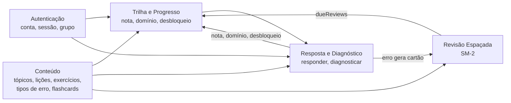

# SRS — Especificação de Requisitos do Estudarias

Um SRS por módulo. Cada um é a referência de aceite das issues do módulo: diz **o que** o sistema deve fazer, as regras de negócio, o que acontece quando dá errado e como cada requisito se liga à implementação e ao teste que o prova. O **como** está nos ADRs (`docs/adr/`) e o formato das requisições e respostas está no [`docs/api.md`](../api.md).

## Os módulos

| Módulo | Prefixo | Status | Issues | O que especifica |
|---|---|---|---|---|
| [Autenticação](SRS%20-%20M%C3%B3dulo%20de%20Autentica%C3%A7%C3%A3o.md) | sem prefixo (`RF-01`, `RN-01`...) | Implementado (o cabeçalho do SRS ainda diz "em implementação") | #35 e sub-issues (#36 a #41, #49) | Cadastro, login, sessão por refresh token, logout, grupo experimental e login obrigatório |
| [Conteúdo](SRS%20-%20M%C3%B3dulo%20de%20Conte%C3%BAdo.md) | `CNT` | Rascunho; Domain pronto | #83, #85 | Tópicos e grafo de pré-requisitos, lições, exercícios, tipos de erro, flashcards, persistência e carga do seed YAML |
| [Trilha e Progresso](SRS%20-%20M%C3%B3dulo%20de%20Trilha%20e%20Progresso.md) | `TRL` | Rascunho; regras do Domain prontas | #84, #86, #87, #91, #92 | Trilha, tópico, lição, nota, domínio, desbloqueio, estado da lição e histórico de respostas |
| [Resposta e Diagnóstico](SRS%20-%20M%C3%B3dulo%20de%20Resposta%20e%20Diagn%C3%B3stico.md) | `RSP` | Rascunho; regras do Domain prontas | #84, #88 | Responder exercício, diagnosticar o tipo de erro, retorno por grupo experimental e "erro gera flashcard" |
| [Revisão Espaçada](SRS%20-%20M%C3%B3dulo%20de%20Revis%C3%A3o%20Espa%C3%A7ada.md) | `REV` | Rascunho; Domain pronto | #84, #89 | Cartão do aluno, revisões do dia, revisar e o SM-2 |

A visão por issue está na [#81](https://github.com/LHPalma/estudarias/issues/81) (API do aprendizado v1), e a ordem de entrega, no corpo dela.

## Como os módulos se ligam



O ciclo do produto atravessa os quatro: **errar** (Resposta) → **diagnosticar o tipo de erro** (Resposta, com o vínculo do Conteúdo) → **flashcard** (Resposta cria, Revisão agenda) → **revisar** (Revisão) → **atualizar a nota** e **desbloquear** (Trilha, chamado pela Resposta).

## Convenções

### Identificadores

Cada requisito tem um id estável, que o código e o histórico citam:

| Tipo | Forma | Exemplo |
|---|---|---|
| Requisito funcional | `RF-<módulo>-NN` | `RF-REV-03` |
| Regra de negócio | `RN-<módulo>-NN` | `RN-TRL-04` |
| Fluxo alternativo ou de exceção | `FA-<módulo>-NN` | `FA-RSP-07` |
| Requisito não funcional | `RNF-<módulo>-NN` | `RNF-CNT-02` |
| Premissa | `P-<módulo>-NN` | `P-TRL-01` |
| Decisão pendente | `PEND-<módulo>-NN` | `PEND-RSP-02` |

O SRS de Autenticação é anterior ao prefixo e usa `RF-01`, `RN-01` e assim por diante. Esses ids ficam como estão, porque os testes dele já os citam; um id sem prefixo é sempre da Autenticação.

Um id nunca é reaproveitado: um requisito que sai fica registrado como removido, não dá lugar a outro.

### Testes e rastreabilidade

O nome de cada teste de fluxo cita o requisito que ele prova (`docs/testing.md`), no `DisplayName`:

```csharp
[Fact(DisplayName = "RN-REV-09: revisar antes do vencimento é aceito")]
```

A Seção 9 de cada SRS é a tabela inversa: requisito → issue/PR → classes de teste. Quando uma issue de implementação é entregue, o PR atualiza a coluna "Implementação" e "Testes" do módulo dela (commit com escopo `srs`).

### Estrutura de um SRS

1. **Introdução**: objetivo, escopo (o que cobre e o que não), definições e visão geral.
2. **Descrição geral**: contexto de negócio, diagrama e atores.
3. **Requisitos funcionais**.
4. **Regras de negócio**.
5. **Fluxos alternativos e de exceção**.
6. **Requisitos não funcionais**.
7. **Restrições, premissas, configuração, o que fica de fora** e, quando há, as **decisões pendentes**.
8. **Modelo de dados** e **catálogo de erros**.
9. **Rastreabilidade**.

### Status

| Status | Significa |
|---|---|
| **Rascunho** | Os requisitos estão escritos, mas ainda há implementação por fazer; a Seção 9 marca cada linha com o que existe e com "a fazer". |
| **Em implementação** | Todos os requisitos têm PR aberto. |
| **Implementado** | Tudo mergeado e rastreado. |

Os rascunhos descrevem o **alvo**: os nomes de tabelas, colunas e portas de leitura que ainda não existem seguem o `docs/schema.dbml` e as issues, e se fixam na implementação.

### Decisões pendentes

Uma decisão em aberto não trava o SRS: ele escreve o requisito pela **proposta atual** e a registra na Seção 7.5 do módulo, com um id `PEND`. Decidida a questão, a pendência sai e o requisito fica como foi decidido (e o ADR, quando há, é citado).

| Id | Pendência | Onde | Decidir antes de |
|---|---|---|---|
| `PEND-RSP-02` | Tipo de erro sem flashcard no conteúdo | [Resposta e Diagnóstico](SRS%20-%20M%C3%B3dulo%20de%20Resposta%20e%20Diagn%C3%B3stico.md) | #85 e #88 |

## Relação com os outros documentos

| Documento | Papel |
|---|---|
| `docs/SRS/` (aqui) | **O quê**: requisitos e regras, com aceite e rastreabilidade |
| [`docs/adr/`](../adr) | **Por quê**: as decisões de arquitetura, com as alternativas e as consequências |
| [`docs/api.md`](../api.md) | **Formato**: rotas, corpos, respostas, erros e links que o app consome |
| [`docs/schema.dbml`](../schema.dbml) | **Dados**: o schema alvo, com dados de exemplo |
| [`docs/testing.md`](../testing.md) | **Prova**: as convenções de teste |

Quando o contrato (`docs/api.md`) e o SRS divergem, o código manda, o contrato é corrigido no mesmo PR e o SRS é atualizado junto.
