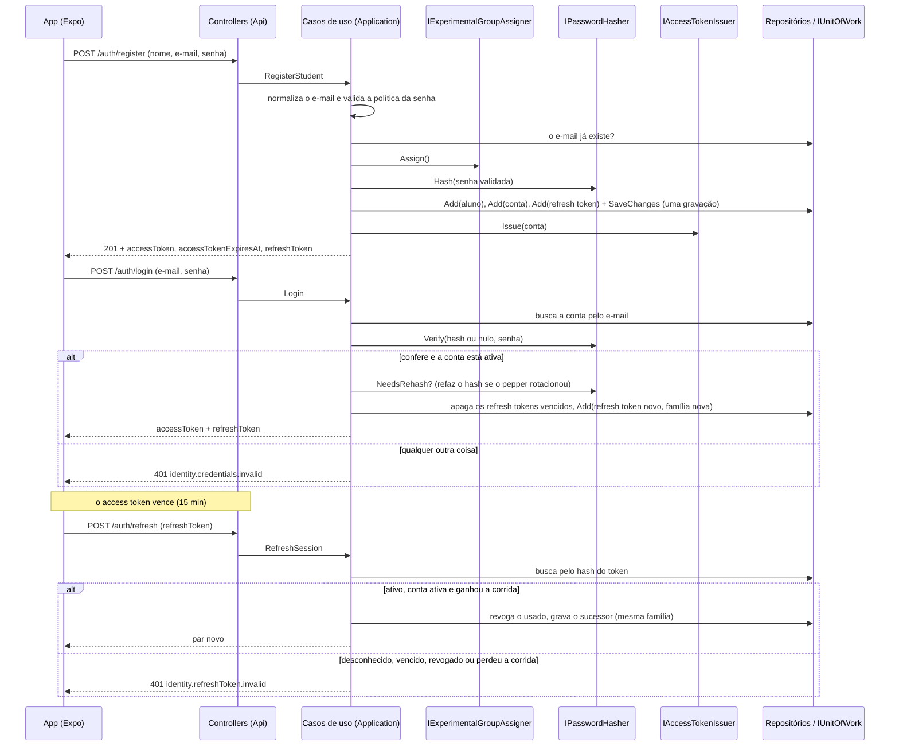
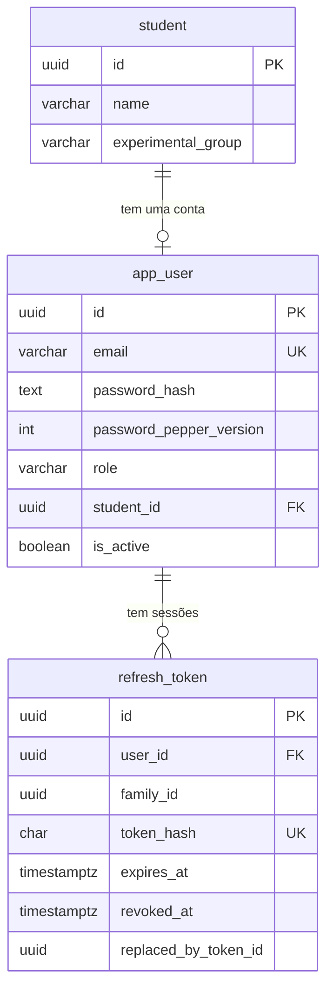

# SRS — Módulo de Autenticação (Cadastro, Login, Sessão e Grupo Experimental)

**Status:** Em implementação. Já tem PR aberto: agregado de identidade (#36, PR #43), persistência (#37, PR #44), hash de senha (#38, PR #46), casos de uso (#39, PR #47) e testes de fluxo contra o PostgreSQL real (#49, PR #51). O access token JWT e a exigência de login na API (#40, PR #55) e os endpoints REST (#41, PR #56) também têm PR aberto: todos os requisitos têm implementação em revisão. Os requisitos abaixo valem para o módulo completo; a Seção 9 diz o que já existe.

---

## 1. Introdução

### 1.1 Objetivo do Documento

Especificar os requisitos funcionais, as regras de negócio, os fluxos de exceção e os requisitos não funcionais do módulo de **Autenticação** do Estudarias: o aluno cria a própria conta, entra com e-mail e senha, mantém a sessão sem digitar a senha de novo e sai. O módulo também decide, no cadastro, em qual grupo do experimento do TCC o aluno entra.

O documento é a referência de aceite dos testes do fluxo (#49) e a base do ADR de autenticação (#42).

### 1.2 Escopo

Cobre:

- **Cadastro** do aluno (`POST /auth/register`): cria a conta e o perfil de estudo e já devolve uma sessão aberta.
- **Atribuição do grupo experimental** no cadastro, com sorteio 50/50 atrás de uma feature flag.
- **Login** (`POST /auth/login`): troca e-mail e senha por um par de tokens.
- **Renovação de sessão** (`POST /auth/refresh`): troca um refresh token por um par novo, com rotação e detecção de reuso.
- **Logout** (`POST /auth/logout`): revoga o refresh token daquele dispositivo.
- **Emissão e validação do access token** (JWT, HS256).
- **Hash e verificação de senha** (Argon2id com pepper versionado) e o re-hash no login.
- **Login obrigatório** em toda a API, exceto nos endpoints de sessão e no `/health`.

Não cobre (ver Seção 7):

- Papéis além de `Student` (professor, líder de equipe) e permissões por equipe.
- Recuperação e troca de senha, e verificação de e-mail (exigem envio de e-mail).
- Bloqueio por tentativas erradas e limite de taxa no login.
- Revogar o access token antes de expirar e "sair de todos os dispositivos".
- Login social e OAuth2.

### 1.3 Definições e Siglas

| Termo | Definição |
|---|---|
| **Aluno (`Student`)** | O perfil de estudo: nome, grupo experimental e progresso por tópico. Não guarda e-mail nem senha. |
| **Conta (`User`)** | A identidade de acesso: e-mail, hash da senha, papel e a ligação (`StudentId`) com o aluno. Separada do aluno de propósito. |
| **Grupo experimental** | `Control` ou `Diagnostic`. Define se o aluno usa o app sem ou com o diagnóstico do tipo de erro. Fica gravado no aluno. |
| **Flag do sorteio** | `ExperimentalGroup:RandomAssignment`. Ligada, o grupo é sorteado; desligada, todo aluno novo cai em `ExperimentalGroup:FallbackGroup`. |
| **Access token** | JWT assinado (HS256), de vida curta (15 minutos), sem estado e nunca persistido. Vai em `Authorization: Bearer <token>`. |
| **Refresh token** | Sequência aleatória de 256 bits (64 caracteres hexadecimais), de uso único, com vida de 30 dias a cada uso. Só o hash SHA-256 é persistido. |
| **Família** | Todos os refresh tokens que descendem de um mesmo login. Um login abre uma família; cada renovação continua a mesma. |
| **Rotação** | Todo uso de um refresh token o revoga e emite um sucessor na mesma família, encadeado por `ReplacedByTokenId`. |
| **Reuso** | Um refresh token já revogado que reaparece. Só pode ter vazado, então a família inteira é revogada. |
| **Pepper** | Segredo global e versionado, fora do banco, usado como o `secret` do Argon2. O sal é por senha e público; o pepper é global e secreto, e um não substitui o outro. |
| **`PasswordHash`** | O hash em formato PHC mais a versão do pepper que o derivou: os dois são necessários para verificar a senha, então viajam juntos. |
| **`Password`** | A senha em texto puro que já passou pela política de composição. É o único tipo que o hasher aceita. |
| **Unidade de trabalho** | Grava de uma vez tudo o que os repositórios marcaram (`IUnitOfWork`). |

### 1.4 Visão Geral do Documento

- **Seção 2**: contexto de negócio, diagrama e atores.
- **Seção 3**: requisitos funcionais (RF-01 a RF-09).
- **Seção 4**: regras de negócio (RN-01 a RN-16).
- **Seção 5**: fluxos alternativos e de exceção (FA-01 a FA-12).
- **Seção 6**: requisitos não funcionais (RNF-01 a RNF-06).
- **Seção 7**: restrições, premissas e o que fica de fora.
- **Seção 8**: modelo de dados e catálogo de erros.
- **Seção 9**: rastreabilidade.

---

## 2. Descrição Geral

### 2.1 Contexto de Negócio

O Estudarias é uma plataforma adaptativa de estudo de matemática, desenvolvida como TCC. O TCC compara dois grupos de alunos: o de **controle** e o de **diagnóstico**, que recebe o diagnóstico do tipo de erro por alternativa e os flashcards gerados pelos erros. Para a comparação valer, cada aluno precisa ser identificado de forma estável (a mesma pessoa é sempre o mesmo aluno, em qualquer aparelho) e cair num grupo no momento do cadastro, sem poder escolher nem trocar.

Por isso o módulo:

- separa a **conta** (quem prova identidade) do **aluno** (quem estuda e é medido no experimento);
- deixa o aluno se cadastrar sozinho, sem convite nem criação por administrador;
- fixa o grupo no cadastro, atrás de uma flag que permite parar o sorteio quando o experimento ainda não começou ou já terminou;
- mantém a sessão por refresh token para o app (Expo) não pedir a senha a toda hora, e permite encerrá-la de propósito (logout).

### 2.2 Diagrama de Contexto

### 2.3 Atores

| Ator | Tipo | Descrição |
|---|---|---|
| **Aluno** | Humano | Cria a conta, entra, usa o app e sai. |
| **App (Expo)** | Sistema | Consome a API REST; guarda os tokens e renova a sessão. Toda a lógica fica no back-end. |
| **Casos de uso** (`RegisterStudent`, `Login`, `RefreshSession`, `Logout`) | Application | Orquestram cada fluxo; não conhecem HTTP, EF Core nem a biblioteca de JWT. |
| **`IPasswordHasher`** / `Argon2PasswordHasher` | Porta (Application) / adapter (Infrastructure) | Deriva e confere senhas. |
| **`IExperimentalGroupAssigner`** / `ExperimentalGroupAssigner` | Porta / adapter | Decide o grupo de um aluno novo, atrás da flag. |
| **`IAccessTokenIssuer`** | Porta (Application) / emissor JWT (Api, #40) | Monta e assina o access token. |
| **`IUserRepository`**, **`IRefreshTokenRepository`**, **`IStudentRepository`**, **`IUnitOfWork`** | Portas / adapters EF Core | Persistência, sem a Application conhecer o EF Core. |
| **Middleware JWT** | Api (#40) | Valida assinatura e expiração do access token em toda requisição. |

---

## 3. Requisitos Funcionais

### RF-01: Cadastro do aluno

**Endpoint:** `POST /auth/register` (#41, PR #56). **Caso de uso:** `RegisterStudent`.

Recebe `name`, `email` e `password`. Normaliza o e-mail (RN-02), valida a política da senha (RN-03), recusa e-mail já cadastrado (FA-01), atribui o grupo experimental (RF-02), deriva o hash da senha (RF-08) e cria, **numa gravação só**, o aluno, a conta ligada a ele (`StudentId`) e o refresh token da primeira sessão (RN-14). Devolve uma sessão aberta: o aluno já entra logado, sem passar pelo login (RF-03). A resposta é `201 Created`.

### RF-02: Atribuição do grupo experimental

Todo aluno nasce num grupo, decidido pelo `IExperimentalGroupAssigner` no cadastro:

- **Flag ligada** (`ExperimentalGroup:RandomAssignment = true`, o padrão): sorteio 50/50 entre `Control` e `Diagnostic`.
- **Flag desligada**: todo aluno novo cai em `ExperimentalGroup:FallbackGroup` (padrão `Diagnostic`), sem sortear.

A flag é lida a cada cadastro, então virar o valor vale na chamada seguinte quando a configuração vem de um arquivo que recarrega. Só afeta cadastros novos (RN-10).

### RF-03: Login

**Endpoint:** `POST /auth/login` (#41, PR #56). **Caso de uso:** `Login`.

Recebe `email` e `password`. Se a conta existir, estiver ativa e a senha conferir, emite um access token (RF-04) e um refresh token novo, numa família nova (RF-05), e devolve `accessToken`, `accessTokenExpiresAt`, `refreshToken` e a conta. Qualquer outra situação falha com `identity.credentials.invalid`, sem dizer qual parte estava errada (RN-01).

O login também refaz o hash quando ele foi derivado com um pepper que não é o corrente (RN-12) e apaga os refresh tokens vencidos do usuário (RN-15).

### RF-04: Emissão do access token

`IAccessTokenIssuer.Issue(conta)` monta um JWT HS256 com as claims `sub` (id da conta), `email` e `role`, e nada mais de dado da conta (nunca a senha, o hash nem o pepper). O emissor e a audiência vêm da configuração (`Jwt:Issuer` e `Jwt:Audience`, padrão `Estudarias`), e o token expira em 15 minutos (`Jwt:AccessTokenMinutes`) a partir da emissão, medida pelo relógio injetado. Devolve também o instante de expiração, para o app renovar sem decodificar o JWT.

Em cada requisição, o middleware confere **emissor, audiência, assinatura e validade**, com 30 segundos de tolerância de relógio, e aceita **só o algoritmo HS256**: um token assinado com outro algoritmo, mesmo com a chave certa, ou sem assinatura, é recusado. **Implementação na #40 (PR #55).**

### RF-05: Emissão e persistência do refresh token

A cada cadastro, login e renovação, um refresh token novo é gerado: 32 bytes aleatórios (`RandomNumberGenerator`) em hexadecimal minúsculo (64 caracteres). O valor cru só existe na resposta ao cliente; o que fica no banco é o SHA-256 dele (RN-05), junto com `UserId`, `FamilyId` e `ExpiresAt = agora + 30 dias`.

### RF-06: Renovação da sessão (rotação)

**Endpoint:** `POST /auth/refresh` (#41, PR #56). **Caso de uso:** `RefreshSession`.

Recebe o refresh token cru e o troca por um par novo. O token recebido é **sempre revogado**, mesmo que ainda não tivesse vencido, e o sucessor nasce na mesma família, apontado por `ReplacedByTokenId`. Cada uso abre uma janela nova de 30 dias, então uma sessão ativa não acaba. Token desconhecido, vencido, revogado ou de conta desabilitada falha com `identity.refreshToken.invalid` (RN-06, RN-07, FA-05 a FA-08).

### RF-07: Logout

**Endpoint:** `POST /auth/logout` (#41, PR #56). **Caso de uso:** `Logout`.

Revoga o refresh token informado, o do dispositivo que está saindo. O access token já emitido vale até expirar (RN-09). Responde `204 No Content`, também para um token desconhecido, vencido ou já revogado (RN-16).

### RF-08: Hash e verificação de senha

`IPasswordHasher` (`Argon2PasswordHasher`):

- **`Hash(Password)`**: Argon2id com 19 MiB, 2 passes, 1 faixa e hash de 32 bytes (o mínimo recomendado pela OWASP), e o pepper corrente como o `secret` do algoritmo. Devolve o `PasswordHash` (texto PHC e versão do pepper).
- **`Verify(PasswordHash?, senha)`**: busca o pepper pela versão gravada no hash. Com hash nulo (conta inexistente), confere contra um hash descartável e devolve falso, gastando o mesmo trabalho (RN-01).
- **`NeedsRehash(PasswordHash)`**: verdadeiro quando a versão do pepper do hash não é a corrente.

### RF-09: Login obrigatório em toda a API

Toda requisição a qualquer endpoint exige um access token válido, exceto `register`, `login`, `refresh`, `logout` e `/health` (e o OpenAPI, só em Development). Um endpoint novo já nasce protegido: a política de autorização padrão exige usuário autenticado, e quem precisa ser aberto declara `AllowAnonymous` de propósito. Requisição sem token válido responde `401`, inclusive numa rota que não existe (a quem tem token, essa rota responde `404`), o que não revela quais rotas existem. **Implementação da política na #40 (PR #55); o `AllowAnonymous` dos endpoints de sessão, na #41 (PR #56).**

---

## 4. Regras de Negócio

### RN-01: Resposta única para credenciais inválidas

E-mail malformado, e-mail desconhecido, senha errada e conta desabilitada falham todos com `identity.credentials.invalid`, e a senha **é sempre conferida**: contra o hash real quando há conta, e contra o hash descartável quando não há. A resposta não diz qual parte estava errada nem leva um tempo diferente, o que impede enumerar e-mails cadastrados.

### RN-02: E-mail normalizado e único

O e-mail é guardado sem espaços nas pontas e em minúsculas, e é o que a conta usa para entrar. Tem até 254 caracteres, exatamente um `@` (que não está no começo nem no fim), nenhum espaço e um ponto no domínio. Duas contas não podem ter o mesmo e-mail (índice único), em qualquer caixa de letras.

### RN-03: Política de senha

A senha tem de 8 a 128 caracteres, com pelo menos uma maiúscula, uma minúscula, um dígito e um caractere especial. A política vale no cadastro, **antes** de qualquer consulta ao banco ou custo de hash, e fica no tipo `Password`, que é o único aceito pelo hasher: nenhum hash sai de uma senha que ninguém validou. Cada regra quebrada tem seu código (Seção 8.3).

### RN-04: A senha nunca é guardada nem exposta

Só o hash fica no banco. O pepper fica **fora** do banco e do texto PHC, então um dump do banco sozinho não permite ataque offline. `Password` e `PasswordHash` não revelam o valor ao serem impressos.

### RN-05: O refresh token nunca é persistido em texto puro

Só o SHA-256 do valor cru fica no banco (`token_hash`, único). Um hash rápido basta porque o token é uma sequência aleatória com 256 bits de entropia, e não uma senha escolhida por uma pessoa.

### RN-06: O refresh token é de uso único, com família

Usar um token o revoga e emite um sucessor na mesma família. Revogar um token que já está revogado é um erro de domínio (`identity.refreshToken.alreadyRevoked`).

### RN-07: A reaparição de um token usado revoga a família inteira

Um token já revogado só reaparece se vazou. Quando isso acontece, todos os tokens ainda não revogados da família são revogados e o pedido falha com `identity.refreshToken.invalid`. O dono legítimo precisa entrar de novo.

### RN-08: A rotação é atômica

De duas renovações simultâneas do mesmo token, só uma vence. A revogação (`revoked_at`) é o token de concorrência: o `UPDATE` da segunda não acha a linha ainda não revogada, e ela recebe `identity.refreshToken.invalid`. Essa garantia só se prova num PostgreSQL de verdade.

### RN-09: O access token é sem estado

Nunca é persistido, então o logout não o revoga: ele vale até expirar (15 minutos). Revogá-lo antes exigiria estado no servidor.

### RN-10: O grupo experimental é definido no cadastro e não muda

O grupo fica gravado no aluno e não é alterado por login, renovação nem por virar a flag do sorteio. A flag só vale para cadastros novos.

### RN-11: O grupo de reserva é válido

`ExperimentalGroup:FallbackGroup` precisa ser um grupo que existe; um valor inválido derruba a subida da API.

### RN-12: O hash é refeito no login quando o pepper rotacionou

O pepper é versionado: a configuração é um mapa versão → pepper e uma versão corrente. Hashes de versões antigas continuam valendo (a verificação busca o pepper pela versão gravada), e o login, o único momento em que a senha em texto puro está à mão, refaz o hash com o pepper corrente. Uma senha que já não cumpre a política mantém o hash antigo e entra normalmente. Uma versão que saiu do mapa é **erro de configuração** (lança `InvalidOperationException`), não "senha errada".

### RN-13: A configuração do pepper é validada na subida

A API não sobe sem nenhum pepper, com a versão corrente fora do mapa ou com qualquer pepper de menos de 32 caracteres, inclusive o de uma versão antiga.

### RN-14: O cadastro é atômico

Aluno, conta e refresh token são gravados juntos: se a gravação falha, nenhum deles entra. Um aluno nunca fica sem conta, e uma conta nunca aponta para um aluno que não existe (chave estrangeira). Um aluno tem uma conta só (`student_id` único).

### RN-15: O login limpa os tokens vencidos do usuário

Os refresh tokens do usuário que já venceram são removidos no login, junto com o resto da gravação, para a tabela não crescer sem fim.

### RN-16: O logout é idempotente do ponto de vista de quem chama

Token desconhecido, vencido, já revogado, ou revogado por outra requisição no meio do caminho: nada disso é erro, e nada é gravado quando não há o que revogar.

---

## 5. Fluxos Alternativos e de Exceção

### FA-01: Cadastro com e-mail já cadastrado

`identity.email.taken` (conflito, `409`). A checagem acontece antes de sortear o grupo e de derivar o hash: nada é gravado e nenhum custo é gasto.

### FA-02: Cadastros simultâneos com o mesmo e-mail

A checagem prévia não fecha a janela entre duas requisições. Quem perde a corrida no índice único (`ux_app_user_email`) recebe a mesma `identity.email.taken`, e só uma conta e um aluno ficam gravados (RN-14).

### FA-03: Cadastro com e-mail inválido, senha fora da política ou nome inválido

`identity.email.invalid`, `identity.password.*` ou `student.name.required` / `student.name.tooLong` (validação, `400`). Nada é consultado, sorteado, derivado nem gravado.

### FA-04: Login com credenciais inválidas

`identity.credentials.invalid` (`401`) para qualquer uma das quatro causas (RN-01). Nada é emitido nem gravado.

### FA-05: Renovação com token desconhecido, nulo ou vencido

`identity.refreshToken.invalid` (`401`). O token vencido não é revogado nem gera sucessor.

### FA-06: Renovação com token já usado (reuso)

Revoga a família inteira e responde `identity.refreshToken.invalid` (RN-07). Se a família já estava toda revogada, nada é gravado. Se outra requisição revogou parte dela no meio do caminho, o resultado é o mesmo.

### FA-07: Renovação de conta desabilitada ou que não existe mais

`identity.refreshToken.invalid`. O token não é revogado.

### FA-08: Renovações simultâneas do mesmo token

Só uma vence (RN-08); a outra recebe `identity.refreshToken.invalid`, e nenhum access token é emitido para ela.

### FA-09: Logout com token que não está ativo

`204`, sem gravar nada (RN-16).

### FA-10: Versão do pepper aposentada cedo demais

A verificação lança erro de configuração (`InvalidOperationException`), que não vira "senha errada". É um defeito de operação, e a resposta é um erro do servidor.

### FA-11: Flag do sorteio desligada

Todo aluno novo cai em `ExperimentalGroup:FallbackGroup`, sem sorteio. Quem já tem grupo não muda (RN-10).

### FA-12: Requisição sem token, ou com token inválido ou vencido

`401` em qualquer endpoint protegido (RF-09), com o desafio `Bearer` e, para um token vencido, dizendo que ele expirou. Vale também para token de outra chave, de outro emissor ou audiência, de outro algoritmo, sem assinatura, adulterado e para lixo no lugar do token. O app responde renovando a sessão (RF-06) e repetindo o pedido.

---

## 6. Requisitos Não Funcionais

### RNF-01: Segurança da senha

Argon2id no custo mínimo da OWASP, com pepper versionado fora do banco (RF-08, RN-04, RN-12). A verificação de uma conta inexistente gasta o mesmo trabalho que a de uma existente (RN-01).

### RNF-02: Segurança da sessão

Access token curto e sem estado; refresh token aleatório, só por hash, de uso único e rotativo, com detecção de reuso (RN-05 a RN-09). A chave de assinatura do JWT é o segredo mais sensível: com ela se forja um token de qualquer aluno.

### RNF-03: Configuração com falha rápida

Pepper ausente, curto ou com versão corrente fora do mapa, e grupo de reserva inexistente, derrubam a subida da API (RN-11, RN-13), em vez de aparecer no primeiro login. Em desenvolvimento, os valores vêm do `appsettings.Development.json`, expostos de propósito e com aviso no arquivo; nos demais ambientes vêm de variáveis de ambiente (Seção 7.3).

### RNF-04: Consistência

As gravações de um caso de uso entram numa gravação só (`IUnitOfWork`). Unicidade, chave estrangeira e as constraints de valor ficam no banco, que é quem fecha as corridas entre requisições (RN-02, RN-08, RN-14).

### RNF-05: Testabilidade

A Application depende só de portas, então os casos de uso são testados com dublês e com o relógio controlado (`TimeProvider`). As garantias que só o PostgreSQL real prova (unicidade, concorrência, atomicidade, constraints) são testadas num contêiner (Testcontainers), nunca com o provider InMemory, que ignora todas elas.

### RNF-06: Nenhum detalhe técnico vazado ao cliente

Os erros de domínio viram respostas com o código `identity.*` ou `student.*` e uma mensagem; exceção inesperada vira erro genérico do servidor. Credenciais inválidas não revelam qual parte falhou (RN-01).

---

## 7. Restrições, Premissas e o que Fica de Fora

### 7.1 Restrições técnicas

- .NET 10, Clean Architecture em quatro projetos (Domain, Application, Infrastructure, Api); a Application não referencia o EF Core.
- PostgreSQL com EF Core; tabelas e colunas em inglês, em snake_case e no singular.
- API REST consumida pelo app Expo; JWT HS256 (um processo só emite e confere, então não há motivo para par de chaves).

### 7.2 Premissas

- **P-01**: a API é servida só por HTTPS em produção (tokens e senhas trafegam no corpo e no cabeçalho).
- **P-02**: o relógio do servidor é a fonte do tempo (`TimeProvider`) e está em UTC.
- **P-03**: o pepper e a chave do JWT são segredos de operação, fora do repositório e fora do banco.
- **P-04**: o app guarda o refresh token no armazenamento seguro do aparelho.

### 7.3 Configuração

| Variável | Para quê |
|---|---|
| `ConnectionStrings__Default` | Connection string do PostgreSQL |
| `PasswordHashing__CurrentPepperVersion` | Versão com que os hashes novos são derivados |
| `PasswordHashing__Peppers__N` | O pepper da versão N (pelo menos 32 caracteres) |
| `ExperimentalGroup__RandomAssignment` | Flag do sorteio (padrão `true`) |
| `ExperimentalGroup__FallbackGroup` | Grupo de todo aluno novo com o sorteio desligado (padrão `Diagnostic`) |
| `Jwt__SigningKey` | Chave de assinatura do access token: pelo menos 32 caracteres. Sem ela a API não sobe |
| `Jwt__Issuer` / `Jwt__Audience` | Emissor e audiência do token (padrão `Estudarias`; não podem ficar em branco) |
| `Jwt__AccessTokenMinutes` | Vida do access token, em minutos (padrão 15; maior que zero) |

### 7.4 Fora do escopo

- Papéis além de `Student`, equipes e permissões por equipe.
- Recuperação e troca de senha, e verificação de e-mail.
- Bloqueio por tentativas erradas e limite de taxa no login.
- Revogar o access token antes de expirar, e "sair de todos os dispositivos".
- Login social e OAuth2.
- Endpoint de perfil (`me`) e troca de grupo.

---

## 8. Modelo de Dados

### 8.1 Diagrama

### 8.2 Tabelas

**`student`**

| Coluna | Tipo | Observação |
|---|---|---|
| `id` | uuid PK | Gerado em código (`Guid.CreateVersion7()`) |
| `name` | varchar(100) NOT NULL | Aparado; obrigatório |
| `experimental_group` | varchar(20) NOT NULL | `control` ou `diagnostic`; constraint `ck_student_experimental_group` |

**`app_user`** (`user` é palavra reservada do PostgreSQL, então a tabela se chama `app_user`)

| Coluna | Tipo | Observação |
|---|---|---|
| `id` | uuid PK | |
| `email` | varchar(254) NOT NULL | Normalizado; índice único `ux_app_user_email` (RN-02) |
| `password_hash` | text NOT NULL | Texto PHC do Argon2id; o pepper não aparece nele |
| `password_pepper_version` | integer NOT NULL | Versão do pepper que derivou o hash (RN-12) |
| `role` | varchar(20) NOT NULL | Só `student`; constraint `ck_app_user_role` |
| `student_id` | uuid, FK `student` (`Restrict`) | Índice único `ux_app_user_student_id`: um aluno, uma conta (RN-14). Aceita nulo para papéis futuros sem aluno |
| `is_active` | boolean NOT NULL | Conta desabilitada não entra nem renova |

**`refresh_token`**

| Coluna | Tipo | Observação |
|---|---|---|
| `id` | uuid PK | |
| `user_id` | uuid NOT NULL, FK `app_user` (`Cascade`) | Estado operacional: sem a conta, o token não tem sentido |
| `family_id` | uuid NOT NULL | Índice `ix_refresh_token_family_id` |
| `token_hash` | char(64) NOT NULL | SHA-256 em hexadecimal; índice único `ux_refresh_token_token_hash` (RN-05) |
| `expires_at` | timestamptz NOT NULL | Emissão + 30 dias |
| `revoked_at` | timestamptz, nulo | Nulo enquanto ativo; **token de concorrência** (RN-08) |
| `replaced_by_token_id` | uuid, nulo | O sucessor, quando a revogação veio de rotação; nulo quando veio de logout ou de reuso |

### 8.3 Catálogo de erros

| Código | Quando | Resposta HTTP (#41) |
|---|---|---|
| `identity.credentials.invalid` | Credenciais inválidas (RN-01) | 401 |
| `identity.refreshToken.invalid` | Refresh token desconhecido, vencido, revogado, de conta desabilitada, ou que perdeu a corrida | 401 |
| `identity.refreshToken.alreadyRevoked` | Revogar um token já revogado: erro de domínio que o fluxo normal não provoca, porque os casos de uso checam a revogação antes | 409 |
| `identity.email.invalid` | E-mail que não é um endereço | 400 |
| `identity.email.taken` | E-mail já cadastrado, inclusive na corrida | 409 |
| `identity.password.tooShort` / `tooLong` | Menos de 8 ou mais de 128 caracteres | 400 |
| `identity.password.noUppercase` / `noLowercase` / `noDigit` / `noSpecial` | Falta uma classe de caractere | 400 |
| `identity.passwordHash.invalid` | Hash que não é PHC ou versão de pepper menor que 1: um defeito interno que o cliente não consegue provocar, porque o hash nasce no servidor | 400 (é uma exceção de validação) |
| `student.name.required` / `student.name.tooLong` | Nome vazio ou com mais de 100 caracteres | 400 |

---

## 9. Rastreabilidade

| Requisito | Implementação | Testes |
|---|---|---|
| RF-01, RN-14, FA-01 a FA-03 | #39 (PR #47); persistência #37 (PR #44) | `RegisterStudentHandlerTests`; `UserRepositoryTests`; `EfUnitOfWorkTests`; `RegisterFlowTests` |
| RF-02, RN-10, RN-11, FA-11 | #39 (PR #47) | `ExperimentalGroupAssignerTests`; `ExperimentalGroupOptionsTests`; `RegisterStudentHandlerTests`; `StudentRepositoryTests`; `RegisterFlowTests` |
| RF-03, RN-01, RN-12, RN-15, FA-04 | #39 (PR #47) | `LoginHandlerTests`; `LoginFlowTests` |
| RF-04, RF-09, FA-12 | #40 (PR #55) | `JwtAccessTokenIssuerTests`; `JwtOptionsTests`; `JwtCurrentUserTests`; `AuthenticationPipelineTests` |
| RF-05, RN-05, RN-06 | #36 (PR #43), #39 (PR #47) | `RefreshTokenTests`; `RefreshTokenSecretTests`; `SessionTokensTests`; `RefreshTokenRepositoryTests`; `RegisterFlowTests` |
| RF-06, RN-07, RN-08, FA-05 a FA-08 | #39 (PR #47) | `RefreshSessionHandlerTests`; `EfUnitOfWorkTests`; `SessionFlowTests` |
| RF-07, RN-09, RN-16, FA-09 | #39 (PR #47) | `LogoutHandlerTests`; `SessionFlowTests` |
| RF-08, RN-03, RN-04, RN-13, FA-10 | #36 (PR #43), #38 (PR #46) | `PasswordTests`; `PasswordHashTests`; `Argon2PasswordHasherTests`; `PasswordHashingOptionsTests`; `RegisterFlowTests`; `LoginFlowTests` |
| Endpoints e códigos HTTP (Seção 8.3), RNF-06 | #41 (PR #56) | `RegisterEndpointTests`; `LoginEndpointTests`; `SessionEndpointTests`; `UnexpectedErrorEndpointTests`; `DomainExceptionHandlerTests` |
| Fluxo de ponta a ponta contra o PostgreSQL real, num contêiner (RF-01 a RF-08) | #49 (PR #51) | `RegisterFlowTests`; `LoginFlowTests`; `SessionFlowTests`: cada teste cita no nome o requisito que prova |

---

*Documento gerado em 09-11-2026, referente às sub-issues da #35. Os requisitos valem para o módulo completo. As seções que dependem de PRs ainda em revisão serão revistas se a implementação mudar na revisão.*
