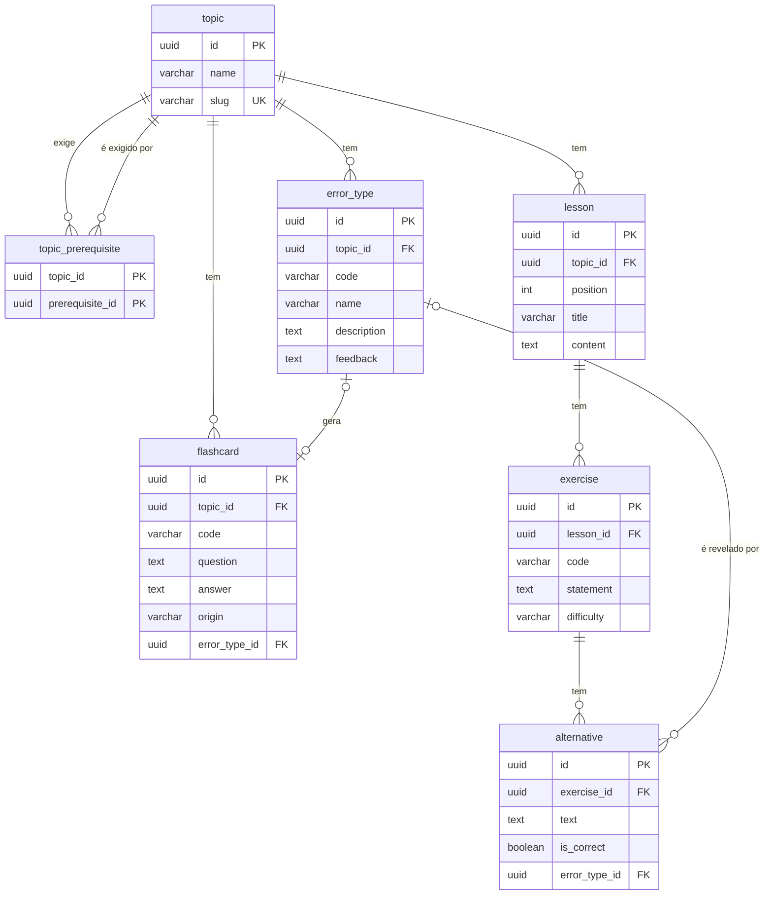

# SRS — Módulo de Conteúdo (Tópicos, Lições, Exercícios, Tipos de Erro e Flashcards)

**Status:** Em implementação. Os agregados do conteúdo já estão no Domain e na `main` (Topic #17, Lesson #27, ErrorType #28, Exercise #29 e Flashcard #31, nos PRs #25, #65, #63, #77 e #67). A persistência (#83) está implementada: mapeamento, restrições, migration `AddContent` e testes de integração (Seção 8.3). A carga do seed YAML e o conteúdo inicial (#85) também estão implementados: o comando `seed`, o validador, a carga com upsert e os arquivos `content/operacoes-basicas.yaml`, `content/fracoes.yaml` e `content/equacoes-1-grau.yaml` (Seção 8.4). Os requisitos abaixo valem para o módulo completo; a Seção 9 diz o que já existe.

---

## 1. Introdução

### 1.1 Objetivo do Documento

Especificar os requisitos funcionais, as regras de negócio, os fluxos de exceção e os requisitos não funcionais do **conteúdo** do Estudarias: o que existe para o aluno estudar (tópicos ligados por pré-requisito, lições, exercícios com alternativas, tipos de erro e flashcards) e como esse conteúdo entra no sistema (a carga do seed YAML).

O documento é a referência de aceite da persistência do conteúdo (#83) e da carga (#85), e a base do conteúdo que as leituras de trilha, tópico e lição devolvem (módulo [Trilha e Progresso](SRS%20-%20M%C3%B3dulo%20de%20Trilha%20e%20Progresso.md)).

### 1.2 Escopo

Cobre:

- A **estrutura** do conteúdo e as regras de cada agregado: `Topic`, `ErrorType`, `Lesson`, `Exercise` (com `Alternative`) e `Flashcard`.
- O **grafo de pré-requisitos** entre tópicos.
- A **persistência** do conteúdo (EF Core e PostgreSQL), com as restrições no banco.
- A **carga do conteúdo** a partir de arquivos YAML: formato, validação, upsert por chave natural e execução.
- O **conteúdo inicial**: os tópicos Operações básicas e Frações.

Não cobre (ver Seção 7):

- Edição de conteúdo pela API ou por tela: o conteúdo só é gravado pela carga.
- Flashcards criados pelo aluno ou por professor.
- Versionamento do conteúdo e remoção de itens que saíram do YAML.
- Imagens, vídeos e fórmulas além da marcação de fração (`{1/2}`).
- O que a API devolve do conteúdo e a visão do aluno sobre ele (módulo Trilha e Progresso).

### 1.3 Definições e Siglas

| Termo | Definição |
|---|---|
| **Tópico (`Topic`)** | Uma unidade de estudo (por exemplo, Frações), com nome, `slug` e a lista de pré-requisitos. |
| **Pré-requisito** | Um tópico que precisa estar dominado para o aluno ter acesso a outro. Os pré-requisitos formam um grafo dirigido sem ciclos. |
| **Tópico-raiz** | Tópico sem pré-requisito: já nasce disponível para o aluno novo. |
| **Tipo de erro (`ErrorType`)** | Um erro conceitual conhecido do tópico (por exemplo, somar numeradores e denominadores), com `code`, nome, descrição e o feedback que explica o erro. |
| **Lição (`Lesson`)** | O conteúdo de ensino de um tópico, numerada por `order` a partir de 1. |
| **Exercício (`Exercise`)** | Uma questão de múltipla escolha de uma lição, com dificuldade (`easy`, `medium`, `hard`). |
| **Alternativa (`Alternative`)** | Uma opção do exercício. Exatamente uma é correta; cada errada aponta para o tipo de erro que escolhê-la revela. |
| **Flashcard** | Um cartão de pergunta e resposta de um tópico. `GeneratedByError` nasce de um tipo de erro; `Manual` não. |
| **Seed** | A carga do conteúdo escrito em YAML para o banco. |
| **Chave natural** | O identificador estável de um item no YAML (slug do tópico, `code` do tipo de erro, ordem da lição, `code` do exercício e do flashcard), que permite recarregar sem duplicar nem trocar ids. |
| **Marcação de fração** | `{1/2}` no texto do conteúdo, que o app desenha como fração. |

### 1.4 Visão Geral do Documento

- **Seção 2**: contexto de negócio, diagrama e atores.
- **Seção 3**: requisitos funcionais (RF-CNT-01 a RF-CNT-08).
- **Seção 4**: regras de negócio (RN-CNT-01 a RN-CNT-14).
- **Seção 5**: fluxos alternativos e de exceção (FA-CNT-01 a FA-CNT-08).
- **Seção 6**: requisitos não funcionais (RNF-CNT-01 a RNF-CNT-05).
- **Seção 7**: restrições, premissas e o que fica de fora.
- **Seção 8**: modelo de dados, decisões da persistência e da carga, e catálogo de erros.
- **Seção 9**: rastreabilidade.

---

## 2. Descrição Geral

### 2.1 Contexto de Negócio

O que diferencia o Estudarias é identificar o **tipo de cada erro** do aluno. Isso só é possível porque o conteúdo é escrito para isso: cada alternativa errada de cada exercício carrega o tipo de erro que ela revela, e cada tipo de erro tem o feedback que o explica e um flashcard para revisar depois. Um exercício sem essa informação não alimenta o diagnóstico nem o experimento do TCC.

Por isso o módulo:

- exige que o conteúdo seja **consistente na origem**: uma alternativa errada sem tipo de erro, um tipo de erro de outro tópico ou um ciclo de pré-requisitos são recusados antes de entrar no banco;
- mantém o conteúdo **em arquivos versionados no repositório**, revisados como código, em vez de editados por tela;
- garante que **recarregar o mesmo arquivo não muda ids**, porque tentativas e cartões já gravados apontam para eles;
- mantém o conteúdo **somente leitura** para o resto do sistema.

### 2.2 Diagrama de Contexto

```mermaid
sequenceDiagram
    participant D as Autor do conteúdo
    participant CLI as dotnet run -- seed content/
    participant R as Leitor e validador (YAML)
    participant L as Carga (upsert)
    participant DB as PostgreSQL

    D->>CLI: edita content/fracoes.yaml e roda o comando
    CLI->>R: lê todos os arquivos da pasta
    R->>R: valida cada item (agregados) e o conjunto (grafo, chaves, tipos de erro)
    alt algum arquivo inválido
        R-->>D: mensagens com arquivo e item; nada é gravado
    else tudo válido
        CLI->>L: carga numa transação
        L->>DB: upsert por chave natural (mantém os ids)
        L-->>D: resumo: criados, atualizados, iguais
    end
```

### 2.3 Atores

| Ator | Tipo | Descrição |
|---|---|---|
| **Autor do conteúdo** | Humano | Escreve os YAML e roda a carga. Hoje, a própria equipe do TCC. |
| **Leitor e validador do seed** | Sistema | Lê os arquivos, valida e monta os agregados. |
| **Carga** | Sistema | Grava os agregados numa transação, por chave natural. |
| **Agregados de conteúdo** (`Topic`, `ErrorType`, `Lesson`, `Exercise`, `Flashcard`) | Domain | Guardam as regras de cada item. |
| **Módulos de leitura** (trilha, tópico, lição) | Application | Consomem o conteúdo; nunca o alteram. |

---

## 3. Requisitos Funcionais

### RF-CNT-01: Estrutura do conteúdo

O conteúdo é uma árvore a partir do tópico:

- um **tópico** tem tipos de erro, lições e flashcards;
- uma **lição** tem exercícios;
- um **exercício** tem alternativas, e cada alternativa errada aponta para um tipo de erro do mesmo tópico.

Cada item tem um id (GUID v7, gerado em código) e as regras de validação do seu agregado (RN-CNT-01 a RN-CNT-07).

### RF-CNT-02: Grafo de pré-requisitos

Um tópico declara de quais outros depende (`Topic.Prerequisites`). O grafo define a ordem da trilha e o desbloqueio (módulo Trilha e Progresso). Um tópico sem pré-requisito é a raiz do grafo.

### RF-CNT-03: Exercício com alternativas diagnósticas

Um exercício tem enunciado, dificuldade e, no mínimo, 2 alternativas, **exatamente uma correta**. A alternativa correta não tem tipo de erro; toda errada tem um. É esse vínculo que permite ao módulo Resposta e Diagnóstico dizer **qual erro** o aluno cometeu.

### RF-CNT-04: Flashcard

Um flashcard tem pergunta e resposta e pertence a um tópico. O flashcard **gerado por erro** está preso a um tipo de erro, e há **um só por tipo de erro** (global, não por aluno): é ele que o módulo Revisão Espaçada entrega a quem comete aquele erro. O flashcard **manual** não tem tipo de erro.

### RF-CNT-05: Persistência do conteúdo (#83)

Os agregados são mapeados no EF Core, com as tabelas `topic`, `topic_prerequisite`, `error_type`, `lesson`, `exercise`, `alternative` e `flashcard` (Seção 8.2), as restrições no banco (RN-CNT-10) e uma migration (`AddContent`). As decisões do mapeamento estão na Seção 8.3. A Application lê o conteúdo por visões `AsNoTracking` no `IApplicationDbContext` (ADR-002); **não há repositório de escrita** do conteúdo, porque só a carga o grava.

### RF-CNT-06: Carga do conteúdo (#85)

Um comando (`dotnet run --project src/Estudarias.Api -- seed "$PWD/content"`, com o caminho absoluto: o `dotnet run` roda no diretório do projeto) lê os arquivos YAML da pasta, **valida tudo** (RF-CNT-07) e grava numa **única transação**:

- **Formato:** um arquivo por tópico em `content/<slug>.yaml`, com nome, slug, pré-requisitos (por slug), tipos de erro, lições, exercícios (com as alternativas e o tipo de erro de cada errada) e flashcards.
- **Chave natural e upsert:** cada item é identificado por uma chave estável do YAML (RN-CNT-11). Recarregar o mesmo arquivo não duplica nada e **mantém os ids**.
- **Campo novo `code`:** exercício e flashcard ganham um `code` nos agregados e no schema, para terem chave natural.
- **A ordem do arquivo é gravada:** a posição do exercício na lição e a das alternativas no exercício vêm da ordem das listas do YAML (#104). Recarregar com a ordem trocada atualiza as posições e não troca nenhum id.
- **Saída:** um resumo de itens criados, atualizados e já iguais.

### RF-CNT-07: Validação do conteúdo

Antes de gravar qualquer coisa, o validador confere, com mensagens que dizem **o arquivo e o item**:

- o que os agregados já validam (RN-CNT-01 a RN-CNT-07);
- pré-requisito que não existe (por slug) e **ciclo** no grafo (RN-CNT-08);
- tipo de erro **de outro tópico** numa alternativa ou num flashcard (RN-CNT-09);
- **chave natural repetida** dentro do arquivo ou entre arquivos.

Um arquivo inválido **não grava nada**, nem dos arquivos válidos (FA-CNT-01).

### RF-CNT-08: Conteúdo inicial

A carga traz dois arquivos:

- `operacoes-basicas.yaml`: curto, para a trilha ter uma raiz.
- `fracoes.yaml`: completo, com os tipos de erro de soma de frações do documento do projeto, as lições, os exercícios e os flashcards. Depende de Operações básicas.
- `equacoes-1-grau.yaml`: três lições (uma operação, multiplicação e divisão, duas operações), nove exercícios e cinco tipos de erro, cada um com o flashcard, mais um cartão manual. Depende de Frações.

Sem isso não há o que estudar nem o que testar com alunos.

---

## 4. Regras de Negócio

### RN-CNT-01: Tópico

Nome obrigatório (até 100 caracteres, aparado). `slug` obrigatório, com até 100 caracteres, em minúsculas e dígitos separados por hífens simples (`^[a-z0-9]+(-[a-z0-9]+)*$`), único. O slug é estável entre cargas: é a chave natural do tópico.

### RN-CNT-02: Pré-requisito

Um tópico não pode ser pré-requisito de si mesmo nem repetir um pré-requisito. A restrição de ciclos fica no validador do seed (RN-CNT-08), porque o agregado só conhece os ids do próprio tópico.

### RN-CNT-03: Tipo de erro

`code` obrigatório, em minúsculas e dígitos com `_` entre grupos, começando por letra (`^[a-z][a-z0-9]*(_[a-z0-9]+)*$`), com até 100 caracteres, e único **dentro do tópico**. Nome obrigatório (até 100). Feedback obrigatório: é o texto que o grupo diagnóstico vê. A descrição é opcional.

### RN-CNT-04: Lição

`order` a partir de 1 e único dentro do tópico. Título obrigatório (até 150) e conteúdo obrigatório. O conteúdo é texto simples com a marcação de fração (`{1/2}`), a mesma que o app interpreta.

### RN-CNT-05: Exercício

Lição e enunciado obrigatórios; dificuldade válida (`easy`, `medium`, `hard`). Pelo menos 2 alternativas, **exatamente uma correta**, e os textos das alternativas **distintos entre si**, sem diferenciar maiúsculas de minúsculas. O exercício tem uma **posição** na lição, a partir de 1 (a ordem do arquivo), e as alternativas são numeradas a partir de 1 pela ordem em que chegam: a ordem do conteúdo é **gravada**, porque o id (`Guid` v7) não cresce dentro de uma mesma rajada de criação e não serve de ordem (#104). Ao revisar, a alternativa que continua (pelo texto) mantém o id e só muda de posição.

### RN-CNT-06: Alternativa

Texto obrigatório (aparado). A **correta** não tem tipo de erro; a **errada** exige um. Nenhuma outra combinação existe.

### RN-CNT-07: Flashcard

Tópico, pergunta e resposta obrigatórios. O **gerado por erro** exige o tipo de erro; o **manual** nasce sem ele. A origem e o tipo de erro andam juntos: nunca há um sem o outro.

### RN-CNT-08: O grafo de pré-requisitos não tem ciclo nem tópico inexistente

O validador percorre o grafo de todos os arquivos da carga. Um pré-requisito por slug que não existe nos arquivos nem no banco é erro; um ciclo (A depende de B que depende de A, direta ou indiretamente) é erro e a mensagem mostra o caminho.

### RN-CNT-09: O tipo de erro é do mesmo tópico

Toda alternativa errada e todo flashcard gerado por erro apontam para um tipo de erro **do tópico do exercício ou do flashcard**. O agregado não consegue conferir isso (só tem o id), então é regra do validador e, em última instância, do esquema.

### RN-CNT-10: As restrições também ficam no banco

Além do Domain, o banco recusa o que o conteúdo não pode ter:

- índices únicos: `topic.slug`, `(topic_id, code)` em `error_type`, `(topic_id, position)` em `lesson` (a ordem da lição; Seção 8.3), **uma alternativa correta por exercício** (índice parcial) e **um flashcard gerado por tipo de erro** (índice parcial);
- `CHECK`s: pré-requisito diferente do próprio tópico, alternativa correta sem tipo de erro (e errada com), origem do flashcard coerente com o tipo de erro;
- chaves estrangeiras com **`ON DELETE RESTRICT`**: o conteúdo não some em cascata, porque tentativas e cartões dependem dele (as linhas do próprio agregado, pré-requisitos e alternativas, saem com o dono; Seção 8.3);
- enums gravados em minúsculas, com a conversão explícita, como no `student`.

### RN-CNT-11: Chave natural e identidade estável

Os itens são identificados por: slug do tópico; `code` do tipo de erro (dentro do tópico); `order` da lição (dentro do tópico); `code` do exercício e `code` do flashcard, **ambos únicos dentro do tópico** (o exercício pode mudar de lição sem perder o id; Seção 8.4). A carga procura o item pela chave natural: se existe, **atualiza o conteúdo e mantém o id**; se não, cria com id novo. Tentativas e cartões já gravados continuam apontando para o mesmo item.

### RN-CNT-12: A carga é tudo ou nada

Validação e gravação são uma unidade: se qualquer arquivo é inválido, ou a gravação falha, **nenhum** item é criado ou alterado.

### RN-CNT-13: A carga não apaga

Um item que saiu do YAML **não é removido** do banco: os `ON DELETE RESTRICT` e a história dos alunos (tentativas, cartões) impedem. Aposentar conteúdo é uma decisão futura (Seção 7.4).

### RN-CNT-14: O conteúdo é somente leitura fora da carga

Nenhum endpoint, caso de uso ou tela grava conteúdo. A Application lê por visões sem rastreamento (ADR-002), e nenhum repositório de escrita de conteúdo existe.

---

## 5. Fluxos Alternativos e de Exceção

### FA-CNT-01: Arquivo inválido

A carga termina com erro, lista **todas** as falhas (arquivo e item) e **não grava nada**, nem dos arquivos válidos (RN-CNT-12).

### FA-CNT-02: Pré-requisito inexistente

Mensagem com o arquivo, o tópico e o slug que não existe (RN-CNT-08).

### FA-CNT-03: Ciclo no grafo

Mensagem com o caminho do ciclo (RN-CNT-08).

### FA-CNT-04: Tipo de erro de outro tópico

Mensagem com o arquivo, o exercício ou flashcard e o `code` do tipo de erro, dizendo de qual tópico ele é (RN-CNT-09).

### FA-CNT-05: Chave natural repetida

Dois itens com a mesma chave natural no mesmo arquivo (ou o mesmo slug em dois arquivos) são recusados, com os dois locais na mensagem.

### FA-CNT-06: Recarga do mesmo arquivo

Idempotente: nenhum item novo, nenhum id muda, e o resumo diz que tudo já estava igual (RN-CNT-11).

### FA-CNT-07: Exercício novo numa lição já existente

O item é criado com id novo na lição existente. Para quem já a estudava, o estado derivado da lição pode voltar a "em andamento" (módulo Trilha e Progresso, RN-TRL-13).

### FA-CNT-08: O banco recusa o que o validador deixou passar

Uma violação de índice único, `CHECK` ou chave estrangeira (RN-CNT-10) aborta a transação, e a carga termina com erro. É a segunda barreira, e um defeito do validador se for provocada.

---

## 6. Requisitos Não Funcionais

### RNF-CNT-01: Consistência na origem

Conteúdo inconsistente nunca chega ao banco: as regras do Domain, o validador e as restrições do banco se somam (RN-CNT-01 a RN-CNT-10).

### RNF-CNT-02: Idempotência

A carga pode rodar a cada deploy sem efeito colateral: o mesmo conteúdo resulta no mesmo estado e nos mesmos ids (RN-CNT-11, FA-CNT-06).

### RNF-CNT-03: Mensagens acionáveis

Cada erro do validador diz o arquivo, o item e a regra quebrada, para o autor corrigir sem ler o código (RF-CNT-07).

### RNF-CNT-04: Testabilidade contra o PostgreSQL real

As garantias que só o banco prova (índices parciais, `CHECK`, `ON DELETE RESTRICT`, atomicidade da carga) são testadas num contêiner (Testcontainers), nunca com o provider InMemory (`docs/testing.md`).

### RNF-CNT-05: Conteúdo revisável como código

O conteúdo vive em `content/*.yaml` no repositório, entra por pull request e tem o histórico do git. Mudar uma lição é um diff legível.

---

## 7. Restrições, Premissas e o que Fica de Fora

### 7.1 Restrições técnicas

- .NET 10, Clean Architecture em quatro projetos; a carga roda no projeto `Estudarias.Api` como comando (`-- seed content/`) e usa o YamlDotNet na Infrastructure.
- PostgreSQL com EF Core; tabelas e colunas em inglês, em snake_case e no singular (as de conteúdo passam para o inglês no `docs/schema.dbml` na #83).
- O app não conhece o conteúdo além do que a API devolve; a marcação `{1/2}` é o contrato de texto entre os dois repositórios.

### 7.2 Premissas

- **P-CNT-01**: o conteúdo é escrito e revisado pela equipe do projeto, não por alunos.
- **P-CNT-02**: a carga roda em ambiente controlado (deploy ou máquina do desenvolvedor), com acesso ao banco.
- **P-CNT-03**: os ids dos itens existentes nunca são reaproveitados para outro item.

### 7.3 Configuração

A carga usa a mesma `ConnectionStrings__Default` da API. Não há variável própria.

### 7.4 Fora do escopo

- Edição de conteúdo pela API ou por tela, e o papel de professor ou pesquisador.
- Flashcards criados pelo aluno.
- Versionamento do conteúdo, aposentadoria e remoção de itens que saíram do YAML.
- Mídia e fórmulas além de `{a/b}`.
- Mais de um tópico de pré-requisito por dependência com regra própria (por exemplo, "qualquer um de"): todos os pré-requisitos são exigidos.

---

## 8. Modelo de Dados

### 8.1 Diagrama



### 8.2 Tabelas e restrições

As tabelas seguem o `docs/schema.dbml`, já em inglês para o conteúdo desde a #83. Os nomes de coluna do diagrama são os do banco, com uma exceção: a ordem da lição é a coluna **`position`** (veja a Seção 8.3). O que não é óbvio, com o nome de cada restrição como está na migration `AddContent`:

| Tabela | Restrições |
|---|---|
| `topic` | `slug` único: `ux_topic_slug` (RN-CNT-01) |
| `topic_prerequisite` | PK `PK_topic_prerequisite` em `(topic_id, prerequisite_id)`; `ck_topic_prerequisite_not_self`: `CHECK (topic_id <> prerequisite_id)`; índice `ix_topic_prerequisite_prerequisite_id`; ciclos barrados pelo validador (RN-CNT-08) |
| `error_type` | único `(topic_id, code)`: `ux_error_type_topic_id_code` (RN-CNT-03) |
| `lesson` | único `(topic_id, position)`: `ux_lesson_topic_id_position`; `ck_lesson_position`: `CHECK (position >= 1)` (RN-CNT-04) |
| `exercise` | `ck_exercise_difficulty`: `CHECK (difficulty IN ('easy', 'medium', 'hard'))`; `ck_exercise_position`: `CHECK (position >= 1)` (sem índice único: a recarga pode trocar duas posições); `code` único na lição: `ux_exercise_lesson_id_code`, que também serve à chave estrangeira (a carga exige o código único no tópico; o banco garante o que consegue sem a coluna do tópico) |
| `alternative` | `ck_alternative_error_type`: `CHECK ((is_correct AND error_type_id IS NULL) OR (NOT is_correct AND error_type_id IS NOT NULL))`; `ck_alternative_position`: `CHECK (position >= 1)`; índice único parcial `ux_alternative_exercise_id_correct` em `(exercise_id) WHERE is_correct` (no máximo uma correta); índices `ix_alternative_exercise_id` e `ix_alternative_error_type_id`; "tipo de erro do mesmo tópico" no validador (RN-CNT-09) |
| `flashcard` | `ck_flashcard_origin`: `CHECK (origin IN ('manual', 'generated_by_error'))`; `ck_flashcard_error_type`: `CHECK ((origin = 'generated_by_error') = (error_type_id IS NOT NULL))`; índice único parcial `ux_flashcard_error_type_id_generated` em `(error_type_id) WHERE origin = 'generated_by_error'` (RN-CNT-07, RN-CNT-10); `code` único no tópico: `ux_flashcard_topic_id_code`, que também serve à chave estrangeira |

Todas as chaves estrangeiras entre itens do conteúdo são `ON DELETE RESTRICT`. As duas exceções são as ligações de uma linha com o próprio agregado, `topic_prerequisite.topic_id` e `alternative.exercise_id`, que são `ON DELETE CASCADE` (Seção 8.3). Os enums (`difficulty`, `origin`) são gravados como texto em minúsculas, com a conversão explícita no mapeamento.

### 8.3 Decisões da persistência (#83)

- **A ordem da lição fica na coluna `position`.** `order` é palavra reservada do SQL e exigiria aspas em todo SQL escrito à mão, inclusive nas `CHECK`s. É o mesmo motivo de a tabela de conta se chamar `app_user`. No Domain, a propriedade continua `Lesson.Order`; o nome muda só no banco.
- **O pré-requisito é um tipo próprio no Domain (`TopicPrerequisite`).** O EF Core não grava uma `List<Guid>` numa tabela de junção, só numa coluna (JSON ou array), o que perderia a PK, a `CHECK` e a chave estrangeira de `topic_prerequisite`. O `Topic` guarda os pré-requisitos como `TopicPrerequisite` num campo privado, mapeado como coleção do agregado (*owned*), e `Topic.Prerequisites` continua devolvendo só os ids: o `TopicMastery` e os testes do Domain não mudaram.
- **Numa consulta, os pré-requisitos são lidos pelo campo mapeado.** Como não há propriedade pública mapeada, a leitura usa `EF.Property<IEnumerable<TopicPrerequisite>>(topic, "_prerequisites")`, como documenta o `IApplicationDbContext`.
- **As alternativas são parte do agregado `Exercise`.** Mapeadas como coleção *owned* na tabela `alternative`, carregam e gravam junto com o exercício, sem `Include`. O `Exercise` ganhou um construtor privado só com as propriedades simples, para o EF Core montá-lo ao ler; o `Create` continua sendo a única entrada com validação.
- **As linhas do próprio agregado saem em cascata com o dono.** `topic_prerequisite.topic_id` e `alternative.exercise_id` são `ON DELETE CASCADE`, o comportamento padrão de uma coleção *owned* no EF Core. A primeira versão da #83 as deixava `RESTRICT`, mas o snapshot das migrations não consegue registrar outro comportamento nessa ligação: o modelo ficava sempre "com mudanças pendentes", e o EF Core se recusava a migrar o banco. A proteção do RN-CNT-10 continua onde importa: um tópico exigido por outro é barrado pela FK de `prerequisite_id`, e as alternativas ficam protegidas pelas FKs que apontam para elas (a tentativa, na #84), que são `RESTRICT`. O teste `MigrationsTests` (em `Infrastructure.UnitTests`, sem banco) compara o modelo com o snapshot e quebra se um mapeamento ficar sem migration.
- **O conteúdo não tem repositório de escrita** (RN-CNT-14). A Application lê pelas visões `AsNoTracking` do `IApplicationDbContext` (`Topics`, `ErrorTypes`, `Lessons`, `Exercises`, `Flashcards`); quem grava é a carga da #85, pelo `AppDbContext`.
- **A ordem dos exercícios e das alternativas é gravada (#104).** Colunas `position` em `exercise` e `alternative`, com `CHECK (position >= 1)` e sem índice único (a recarga pode trocar duas posições, e a unicidade recusaria a troca no meio da gravação). O id não serve de ordem: um `Guid` v7 não cresce dentro de uma mesma rajada de criação (em 189 de 200 rajadas de 4 ids a ordem de criação se perdeu). A migration `AddContentOrder` numera as linhas que já existem pela ordem do id, que não é a do YAML, então recarregar o conteúdo (`seed`) a corrige. `Exercise.Alternatives` devolve as alternativas por posição.
- **Testes** (`ContentConfigurationTests`, PostgreSQL real via Testcontainers, RNF-CNT-04): ida e volta de cada agregado (com alternativas e pré-requisitos), a leitura dos pré-requisitos numa consulta, a leitura sem rastreamento, cada restrição da tabela acima provocada por SQL direto (conferindo o código do erro e o nome da restrição), os casos que devem ser aceitos (o mesmo `code` de tipo de erro em outro tópico, várias alternativas erradas), o `ON DELETE RESTRICT` de cada item referenciado e a cascata das alternativas com o exercício.

### 8.4 Decisões da carga (#85)

- **Arquitetura.** O validador (`ContentValidator`) é lógica pura na Application, sobre os documentos lidos do YAML (`ContentFile`, `TopicDocument`...). Ele monta cada agregado pelo Domain para aplicar as mesmas regras, sem duplicá-las. O leitor YAML (`YamlContentReader`, com o YamlDotNet) e a carga (`ContentLoader`, a única escrita do conteúdo, pelo `AppDbContext`) ficam na Infrastructure, atrás da porta `IContentLoader`. O comando `seed` fica na API (`Commands/SeedCommand`): ele usa a mesma composição e a mesma connection string, carrega e termina sem subir o servidor.
- **Formato.** As chaves do YAML são em camelCase (`errorTypes`, `errorType`). Uma chave desconhecida é erro, com a linha, e não um campo ignorado: um erro de digitação não some em silêncio. A alternativa sem `correct` é errada. O flashcard com `errorType` é o gerado por aquele erro, e sem, manual. O arquivo precisa se chamar `<slug>.yaml`.
- **Códigos novos no Domain.** `Exercise.Code` e `Flashcard.Code` são obrigatórios e seguem o formato dos códigos de tipo de erro (`ContentCode`: minúsculas e dígitos com `_`, começando por letra). Os dois são **únicos no tópico** na carga. No banco, o exercício é único por `(lesson_id, code)` e o flashcard por `(topic_id, code)` (migration `AddContentCodes`).
- **Revisão pelo Domain.** Cada agregado ganhou um método de revisão com as regras da criação, que valida tudo antes de mudar qualquer coisa: `Topic.Rename` e `Topic.ReplacePrerequisites`, `ErrorType.Revise`, `Lesson.Revise`, `Exercise.Revise` e `Flashcard.Revise`. A chave natural nunca muda.
- **Pré-requisitos.** A lista do YAML vale inteira: o que saiu deixa de ser pré-requisito, e o que continua é a mesma linha. O validador monta o grafo com os tópicos dos arquivos e os do banco que não estão na carga, então acha um ciclo que passa por um tópico que só está no banco.
- **Alternativas.** Numa revisão, as alternativas são casadas pelo texto, sem diferenciar maiúsculas. A que continua mantém o id e assume a correção e o tipo de erro novos; a nova entra com id novo. **Remover uma alternativa de um exercício já carregado é recusado** (`exercise.alternative.removed`), porque as tentativas apontam para ela. Para trocar as alternativas, crie um exercício com código novo.
- **Resumo.** O resultado conta os itens criados, alterados e iguais pelo rastreamento do EF Core. Um item conta como alterado quando muda alguma coluna dele ou alguma linha da coleção do agregado (alternativa, pré-requisito). Revisar com os mesmos valores não muda nada, então a recarga dá tudo igual (FA-CNT-06).
- **Problemas que só aparecem com o banco**, como a alternativa removida, são listados com o arquivo e o item, como os do validador, e também não gravam nada.

### 8.5 Catálogo de erros

São erros de domínio da construção dos agregados. **Nenhum vira resposta HTTP**: o conteúdo só entra pela carga, e o validador os traduz em mensagens com arquivo e item (RNF-CNT-03).

| Agregado | Códigos |
|---|---|
| `Topic` | `topic.name.required`, `topic.name.tooLong`, `topic.slug.required`, `topic.slug.invalid`, `topic.prerequisite.self`, `topic.prerequisite.duplicated` |
| `ErrorType` | `errorType.topic.required`, `errorType.code.required`, `errorType.code.invalid`, `errorType.name.required`, `errorType.name.tooLong`, `errorType.feedback.required` |
| `Lesson` | `lesson.topic.required`, `lesson.order.invalid`, `lesson.title.required`, `lesson.title.tooLong`, `lesson.content.required` |
| `Exercise` | `exercise.lesson.required`, `exercise.statement.required`, `exercise.difficulty.invalid`, `exercise.alternative.tooFew`, `exercise.alternative.noCorrect`, `exercise.alternative.multipleCorrect`, `exercise.alternative.textRequired`, `exercise.alternative.textDuplicated`, `exercise.alternative.errorTypeRequired`, `exercise.code.required`, `exercise.code.invalid`, `exercise.alternative.removed` |
| `Flashcard` | `flashcard.topic.required`, `flashcard.question.required`, `flashcard.answer.required`, `flashcard.errorType.required`, `flashcard.code.required`, `flashcard.code.invalid` |

---

## 9. Rastreabilidade

| Requisito | Implementação | Testes |
|---|---|---|
| RF-CNT-01, RF-CNT-02, RN-CNT-01, RN-CNT-02 | Domain: #17 (PR #25) | `TopicTests` |
| RF-CNT-01, RN-CNT-03 | Domain: #28 (PR #63) | `ErrorTypeTests` |
| RF-CNT-01, RN-CNT-04 | Domain: #27 (PR #65) | `LessonTests` |
| RF-CNT-03, RN-CNT-05, RN-CNT-06 | Domain: #29 (PR #77) | `ExerciseTests`; `AlternativeTests` |
| RF-CNT-04, RN-CNT-07 | Domain: #31 (PR #67) | `FlashcardTests` |
| Catálogo de erros (Seção 8.5) | Domain: #12 (PR #13) | `DomainErrorCatalogTests` |
| RF-CNT-05, RN-CNT-10, RN-CNT-14 | #83: configurações em `Infrastructure/Persistence/Configurations`, `TopicPrerequisite` no Domain, visões no `IApplicationDbContext` e migration `AddContent` (decisões na Seção 8.3) | `ContentConfigurationTests`: ida e volta de cada agregado; cada restrição recusada pelo banco; `ON DELETE RESTRICT`. `MigrationsTests`: o modelo bate com a migration |
| RN-CNT-05, RN-CNT-10, RF-CNT-06 (a ordem do arquivo) | #104: `Position` em `Exercise` e `Alternative`, `ExerciseConfiguration`, migration `AddContentOrder`, `ContentLoader` | `ExerciseTests` (numeração, `Revise` reordenando e mantendo ids); `ContentConfigurationTests` (`CHECK`s e ida e volta); `AddContentOrderMigrationTests` (o preenchimento das linhas antigas); `ContentLoaderTests` (ordem do arquivo, recarga com a ordem trocada) |
| RF-CNT-06, RN-CNT-11, RN-CNT-12, RN-CNT-13, FA-CNT-06, FA-CNT-07 | #85: `ContentLoader`, `YamlContentReader`, `SeedCommand`, métodos de revisão do Domain, migration `AddContentCodes` | Integração da carga: carga inicial, recarga idempotente, arquivo inválido sem gravar nada |
| RF-CNT-07, RN-CNT-08, RN-CNT-09, FA-CNT-01 a FA-CNT-05 | #85: `ContentValidator` | `ContentValidatorTests` (Application), uma regra por teste; `YamlContentReaderTests` (formato e conteúdo do repositório válido, sem banco) |
| RF-CNT-08 | #85 e #114: `content/operacoes-basicas.yaml`, `content/fracoes.yaml` e `content/equacoes-1-grau.yaml` | `ContentLoaderTests`: carga dos arquivos contra o PostgreSQL real, recarga idempotente, revisão mantendo os ids, alternativa removida e arquivo inválido sem gravar nada |

---

*Documento gerado em 17-11-2026, referente às issues #83 e #85 (e aos agregados já entregues). Os requisitos valem para o módulo completo. O que depende de issues ainda sem implementação será revisto quando elas forem entregues.*
