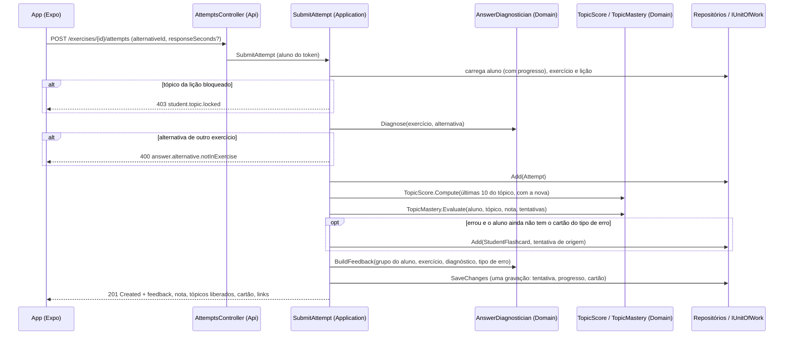
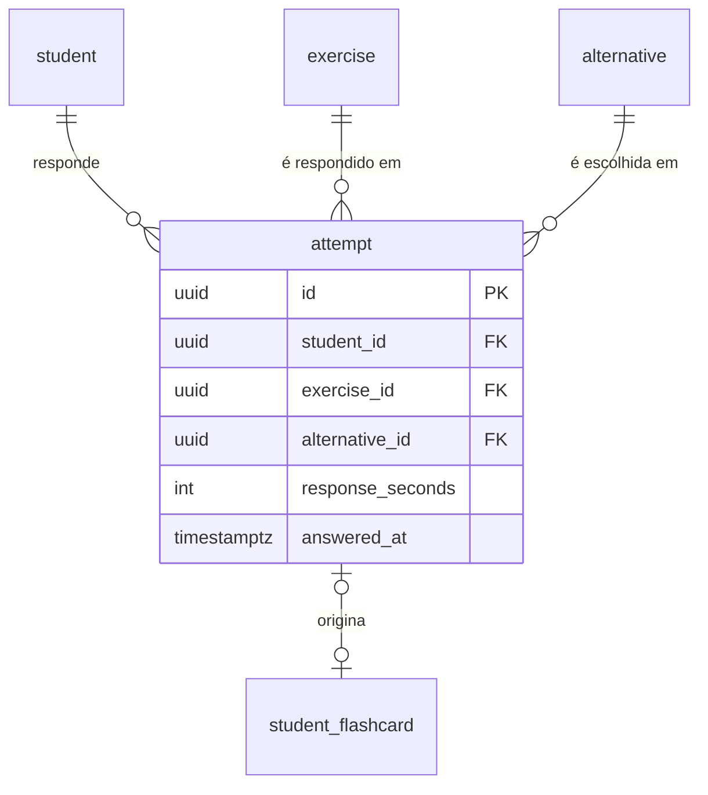

# SRS — Módulo de Resposta e Diagnóstico (Responder Exercício, Diagnosticar o Erro e Retorno por Grupo)

**Status:** Em implementação. As regras puras já estão no Domain e na `main`: a tentativa (`Attempt`, #30, PR #68) e o diagnóstico da resposta com o retorno por grupo experimental (#72, PR #80). A persistência da tentativa (#84) está implementada (tabela `attempt`, Seção 8.2). Faltam o caso de uso e o endpoint `POST /exercises/{id}/attempts` (#88). O contrato está em `docs/api.md` (#82, PR #90). Os requisitos abaixo valem para o módulo completo; a Seção 9 diz o que já existe.

**Decisões:** o cartão nos dois grupos está decidido (ADR-005, ex-PEND-RSP-01). Resta a PEND-RSP-02 (Seção 7.5).

---

## 1. Introdução

### 1.1 Objetivo do Documento

Especificar os requisitos funcionais, as regras de negócio, os fluxos de exceção e os requisitos não funcionais do **ciclo central do produto**: o aluno responde um exercício, o sistema corrige, identifica o **tipo de erro** da alternativa escolhida, devolve o retorno conforme o grupo do experimento, recalcula a nota, avalia o domínio e o desbloqueio e, se errou, cria o flashcard do erro. Tudo numa chamada só.

É o caso de uso central (UC05 e UC06 do documento do projeto) e o ponto onde o experimento do TCC se materializa: o grupo **diagnóstico** recebe o nome e a explicação do erro; o grupo **controle** recebe só a informação de que errou.

O documento é a referência de aceite do caso de uso `SubmitAttempt` e do endpoint `POST /exercises/{exerciseId}/attempts` (#88).

### 1.2 Escopo

Cobre:

- **Responder um exercício** (`POST /exercises/{exerciseId}/attempts`).
- O **diagnóstico** da resposta: correta ou não, qual é a correta e qual tipo de erro a alternativa escolhida revela.
- O **retorno por grupo experimental** (`correct`, `incorrect`, `incorrectWithDiagnosis`).
- O **registro da tentativa**, com o tempo de resposta opcional.
- O **recálculo da nota**, a avaliação do **domínio** e o **desbloqueio**, na mesma chamada.
- A regra **"erro gera flashcard"**.
- O **estado da lição** devolvido na resposta (#91).

Não cobre (ver Seção 7):

- As fórmulas da nota, do domínio e do desbloqueio: são do módulo [Trilha e Progresso](SRS%20-%20M%C3%B3dulo%20de%20Trilha%20e%20Progresso.md), que este módulo chama.
- O agendamento e a revisão do cartão: são do módulo [Revisão Espaçada](SRS%20-%20M%C3%B3dulo%20de%20Revis%C3%A3o%20Espa%C3%A7ada.md); aqui o cartão apenas nasce.
- A exibição do histórico de respostas (módulo Trilha e Progresso, RF-TRL-08).
- Textos prontos de retorno: as mensagens ("Resposta correta", "Resposta incorreta") são do app.
- Resposta aberta, exercício com mais de uma correta e correção por professor.

### 1.3 Definições e Siglas

| Termo | Definição |
|---|---|
| **Tentativa (`Attempt`)** | O registro de uma resposta: aluno, exercício, alternativa escolhida, tempo de resposta opcional e o instante. Nunca é alterada nem apagada. |
| **Diagnóstico (`AnswerDiagnosis`)** | O resultado da correção: se a escolhida está certa, qual é a correta e, se errou, o tipo de erro que a escolhida revela. |
| **Retorno (`AnswerFeedback`)** | O que o aluno vê depois de responder, conforme o grupo: a categoria (`kind`), a resposta correta e, só no grupo diagnóstico, o nome e o feedback do tipo de erro. |
| **Grupo experimental** | `Control` ou `Diagnostic`, fixado no cadastro (módulo Autenticação, RN-10). |
| **Tipo de erro** | O erro conceitual que uma alternativa errada revela (módulo Conteúdo). |
| **Flashcard gerado por erro** | O cartão global ligado a um tipo de erro; o aluno que comete o erro passa a tê-lo para revisar. |
| **Cartão do aluno (`StudentFlashcard`)** | O estado de revisão de um flashcard para um aluno; nasce deste módulo. |
| **Unidade de trabalho** | Grava de uma vez tudo o que o caso de uso marcou (`IUnitOfWork`). |
| **`SubmitAttempt`** | O caso de uso que orquestra tudo isso. |

### 1.4 Visão Geral do Documento

- **Seção 2**: contexto de negócio, diagrama e atores.
- **Seção 3**: requisitos funcionais (RF-RSP-01 a RF-RSP-08).
- **Seção 4**: regras de negócio (RN-RSP-01 a RN-RSP-15).
- **Seção 5**: fluxos alternativos e de exceção (FA-RSP-01 a FA-RSP-11).
- **Seção 6**: requisitos não funcionais (RNF-RSP-01 a RNF-RSP-05).
- **Seção 7**: restrições, premissas, o que fica de fora e as decisões pendentes.
- **Seção 8**: modelo de dados e catálogo de erros.
- **Seção 9**: rastreabilidade.

---

## 2. Descrição Geral

### 2.1 Contexto de Negócio

O diferencial do Estudarias é o ciclo **errar → classificar o tipo de erro → feedback direcionado → flashcard → revisar → atualizar a nota → desbloquear o próximo tópico**. Este módulo é a primeira metade dele: do erro até o flashcard e a nota.

O TCC compara dois grupos de alunos. A única diferença **pretendida** entre eles é o retorno imediato ao erro: o grupo diagnóstico vê "Você somou numerador com numerador e denominador com denominador" e a explicação; o controle vê só que errou. Por isso o módulo:

- corrige e classifica **no servidor**, com o gabarito que o app nunca recebe antes;
- decide o retorno **pelo grupo gravado no aluno**, nunca por um parâmetro da requisição;
- devolve a **mesma estrutura** para os dois grupos, trocando só o conteúdo do retorno;
- grava a tentativa com o **tempo de resposta**, que alimenta a análise do experimento;
- faz tudo numa **única gravação**, para a nota, o desbloqueio e o cartão nunca ficarem em desacordo com a tentativa.

### 2.2 Diagrama de Contexto

### 2.3 Atores

| Ator | Tipo | Descrição |
|---|---|---|
| **Aluno** | Humano | Escolhe uma alternativa e vê o retorno. |
| **App (Expo)** | Sistema | Envia a escolha e o tempo; mostra o retorno e o desbloqueio; as mensagens fixas ("Resposta correta") são dele. |
| **`SubmitAttempt`** | Caso de uso (Application) | Orquestra o ciclo. |
| **`AnswerDiagnostician`** | Domain | Corrige, identifica o tipo de erro e monta o retorno por grupo. |
| **`TopicScore`**, **`TopicMastery`** | Domain | Nota e domínio/desbloqueio (módulo Trilha e Progresso). |
| **`StudentFlashcard`** e o **`IReviewScheduler`** | Domain | Criam o cartão do aluno com o primeiro agendamento (módulo Revisão Espaçada). |
| **`IAttemptRepository`**, **`IStudentRepository`**, **`IStudentFlashcardRepository`**, **`IUnitOfWork`** | Portas / adapters EF Core | Persistência, sem a Application conhecer o EF Core. |

---

## 3. Requisitos Funcionais

### RF-RSP-01: Responder exercício

**Endpoint:** `POST /exercises/{exerciseId}/attempts` (#88). **Caso de uso:** `SubmitAttempt`.

Recebe `alternativeId` e, opcionalmente, `responseSeconds`. O aluno é **sempre o dono do token**; nenhuma rota recebe id de aluno (RN-RSP-13). O caso de uso, em ordem:

1. Carrega o aluno (com o progresso), o exercício e a lição; tópico bloqueado → `403 student.topic.locked` (RN-RSP-01).
2. Diagnostica a resposta (RF-RSP-02) e grava a `Attempt` (RF-RSP-04).
3. Recalcula a nota, avalia o domínio e libera os dependentes (RF-RSP-05).
4. Se errou, cria o cartão do tipo de erro, se o aluno ainda não o tem (RF-RSP-06).
5. Monta o retorno por grupo (RF-RSP-03).
6. Grava tudo numa unidade de trabalho e responde `201` (RN-RSP-12).

### RF-RSP-02: Diagnóstico da resposta

`AnswerDiagnostician.Diagnose(exercício, alternativaId)` confere que a alternativa pertence ao exercício (senão, `answer.alternative.notInExercise`) e devolve: se está **correta**, o **id da correta** (sempre) e, se errou, o **id do tipo de erro** que a alternativa revela. É o vínculo "alternativa errada → tipo de erro" do conteúdo que o torna possível (módulo Conteúdo, RF-CNT-03).

### RF-RSP-03: Retorno por grupo

`AnswerDiagnostician.BuildFeedback(grupo, exercício, diagnóstico, tipoDeErro)` monta o retorno sem texto pronto (RN-RSP-05):

| Situação | `kind` | `correctAnswer` | `errorType` |
|---|---|---|---|
| Acertou (qualquer grupo) | `correct` | o texto da correta | `null` |
| Errou, grupo **controle** | `incorrect` | o texto da correta | `null` |
| Errou, grupo **diagnóstico** | `incorrectWithDiagnosis` | o texto da correta | nome e feedback do tipo de erro |

### RF-RSP-04: Registro da tentativa

A `Attempt` guarda aluno, exercício, alternativa escolhida, `responseSeconds` (opcional, inteiro, 0 ou mais) e o instante da resposta (`AnsweredAt`, pelo relógio injetado). Toda resposta é gravada, inclusive a repetição do mesmo exercício (RN-RSP-04).

### RF-RSP-05: Nota, domínio e desbloqueio na mesma chamada

Com a nova tentativa incluída, o caso de uso calcula a nota do tópico sobre as últimas 10 respostas do aluno nele (`TopicScore`) e avalia o domínio e o desbloqueio (`TopicMastery.Evaluate`), conforme as regras do módulo Trilha e Progresso. A resposta traz o tópico com o status, a nota e o número de tentativas **novos**, e a lista `unlockedTopics` dos tópicos liberados **por esta resposta** (vazia na maioria).

### RF-RSP-06: Erro gera flashcard

Se o aluno **errou**, o caso de uso busca o flashcard gerado por aquele **tipo de erro** e, se o aluno ainda **não tem** o cartão dele, cria o `StudentFlashcard` com a **tentativa de origem** e o primeiro agendamento do SM-2 (módulo Revisão Espaçada, RF-REV-01). A resposta traz o cartão criado (`id` e `nextReviewAt`) ou `null` (RN-RSP-10).

### RF-RSP-07: Estado da lição na resposta (#91)

A resposta ganha `lesson` com o `status` novo da lição do exercício, para a tela de fim de lição mostrar "Lição concluída" **só quando for verdade** (módulo Trilha e Progresso, RN-TRL-12).

### RF-RSP-08: Resposta da API

`201 Created`, com o cabeçalho `Location` apontando para a tentativa, e o corpo: `attemptId`, `isCorrect`, `correctAlternativeId`, `feedback`, `topic`, `unlockedTopics`, `flashcard`, `lesson` e `links` (`topic` e `reviews`). Os campos e os exemplos estão em `docs/api.md`.

---

## 4. Regras de Negócio

### RN-RSP-01: Tópico bloqueado não se pratica

Responder um exercício de um tópico que o aluno ainda não tem liberado falha com `student.topic.locked` (`403`), **antes** de qualquer gravação. Nada é gravado: nem a tentativa, nem o progresso, nem o cartão.

### RN-RSP-02: A alternativa precisa ser do exercício

Uma alternativa que não pertence ao exercício falha com `answer.alternative.notInExercise` (`400`) e nada é gravado. Isso impede responder com o id de uma alternativa de outro exercício para sondar o gabarito.

### RN-RSP-03: O tempo de resposta é opcional e não negativo

`responseSeconds` pode faltar; se vier, é inteiro de 0 para cima. Um valor negativo falha com `attempt.responseTime.invalid` (`400`), também garantido por `CHECK (response_seconds >= 0)` no banco. O tempo não influencia a nota nem o retorno: só vai para a análise do experimento.

### RN-RSP-04: Toda resposta é gravada e a tentativa é imutável

Não há unicidade por `(aluno, exercício)`: o aluno pode responder o mesmo exercício quantas vezes quiser, e **cada resposta** vira uma tentativa. Uma tentativa nunca é alterada nem apagada: é a base da nota, do histórico, do estado da lição e da análise do experimento.

### RN-RSP-05: O retorno depende do grupo, e só dele

O grupo vem do **aluno** gravado, nunca da requisição (RN-RSP-13). O retorno do grupo diagnóstico exige o tipo de erro revelado pelo diagnóstico; um aluno diagnóstico que erra sem tipo de erro disponível é um defeito de dados e um erro do servidor, **não** um retorno degradado. A estrutura da resposta é **a mesma** nos dois grupos: muda o conteúdo de `feedback`, nada mais.

### RN-RSP-06: A resposta correta é revelada depois de responder, para os dois grupos

`correctAlternativeId` e `feedback.correctAnswer` vêm sempre, acertando ou errando, em qualquer grupo. Antes de responder, nenhuma leitura revela o gabarito (módulo Trilha e Progresso, RN-TRL-11).

### RN-RSP-07: A API não manda texto pronto

O retorno traz a categoria (`kind`) e os dados do conteúdo; as mensagens fixas ("Resposta correta", "Resposta incorreta") são do app. Assim a tela, o idioma e o tom mudam sem mexer no back.

### RN-RSP-08: A nota considera a resposta que acabou de chegar

A nota devolvida é calculada **depois** de incluir a nova tentativa, sobre as últimas 10 do tópico, e vale para a avaliação do domínio na mesma chamada. A nota que o aluno vê já é a que decide o desbloqueio.

### RN-RSP-09: Um tópico dominado continua praticável

Responder um exercício de um tópico dominado é permitido: a tentativa é gravada e a nota é recalculada, sem rebaixar o status (módulo Trilha e Progresso, RN-TRL-05).

### RN-RSP-10: Erro gera flashcard, uma vez por aluno e por tipo de erro

Errar uma alternativa cria o `StudentFlashcard` do flashcard daquele tipo de erro **se o aluno ainda não o tem**. Errar de novo o mesmo tipo de erro **não** cria outro cartão nem reinicia o agendamento (`flashcard: null` na resposta). Acertar nunca cria cartão. A unicidade é fechada no banco por `(student_id, flashcard_id)`.

### RN-RSP-11: O cartão é do tipo de erro, e a origem é a primeira tentativa

O flashcard é **global** por tipo de erro (módulo Conteúdo, RF-CNT-04); o que é do aluno é o estado de revisão. A `OriginAttemptId` do cartão é a **primeira** tentativa do aluno que revelou aquele tipo de erro.

### RN-RSP-12: A gravação é uma só

Tentativa, progresso (domínio e desbloqueios) e cartão novo são gravados numa unidade de trabalho (`IUnitOfWork`): ou todos entram, ou nenhum. Nunca há nota ou desbloqueio sem a tentativa que os causou, nem cartão sem a tentativa de origem.

### RN-RSP-13: O aluno é o do token

Nenhuma rota recebe id de aluno, e o `SubmitAttempt` usa o aluno do access token. Um aluno nunca responde em nome de outro, e o grupo experimental nunca vem da requisição.

### RN-RSP-14: O cartão nos dois grupos

O cartão nasce para o aluno dos **dois** grupos, com o mesmo agendamento (ADR-005). O experimento mede só o retorno imediato; o grupo controle vê o diagnóstico ao **revisar**, o que é uma limitação declarada da análise. O grupo só decide o `feedback` da resposta.

### RN-RSP-15: Resposta em até 2 segundos em 4G (RNF002)

O caso de uso lê só o necessário (aluno com progresso, exercício com alternativas e as últimas 10 respostas do tópico) e grava tudo numa viagem. O teste funcional **mede** o tempo (RNF-RSP-01).

---

## 5. Fluxos Alternativos e de Exceção

### FA-RSP-01: Acerto

`isCorrect: true`, `feedback.kind: correct`, nota recalculada, domínio avaliado. **Nenhum cartão** é criado (`flashcard: null`) (RN-RSP-10).

### FA-RSP-02: Erro no grupo diagnóstico

`feedback.kind: incorrectWithDiagnosis`, com `errorType.name` e `errorType.feedback`; cartão do tipo de erro criado se o aluno não o tem (RN-RSP-10).

### FA-RSP-03: Erro no grupo controle

`feedback.kind: incorrect`, com `errorType: null`. O cartão é criado como no grupo diagnóstico (RN-RSP-14, ADR-005).

### FA-RSP-04: Erro de um tipo de erro que o aluno já cometeu

O cartão já existe: nenhum cartão novo, nenhum reagendamento, `flashcard: null`. A tentativa é gravada e a nota é recalculada normalmente.

### FA-RSP-05: A resposta domina o tópico e libera dependentes

`topic.status: mastered` e `unlockedTopics` com os tópicos liberados. Quem só tem um pré-requisito dominado e ainda espera outro continua bloqueado (módulo Trilha e Progresso, RN-TRL-06).

### FA-RSP-06: Exercício inexistente

`404 trail.exercise.notFound`. Nada é gravado.

### FA-RSP-07: Tópico bloqueado

`403 student.topic.locked`, sem gravar nada (RN-RSP-01).

### FA-RSP-08: Alternativa de outro exercício

`400 answer.alternative.notInExercise`, sem gravar nada (RN-RSP-02).

### FA-RSP-09: Tempo de resposta negativo ou corpo inválido

`400 attempt.responseTime.invalid` para o tempo negativo; JSON malformado é `400` e corpo que não é JSON é `415`, ambos sem `code`. `alternativeId` ausente ou nulo recebe o mesmo erro de qualquer valor inválido, com `code`.

### FA-RSP-10: Duas respostas simultâneas do mesmo aluno que erram o mesmo tipo de erro

As duas tentativas são gravadas, mas só **um** cartão pode existir: o índice único `(student_id, flashcard_id)` recusa o segundo. O comportamento esperado é a segunda resposta tratar o cartão como já existente (`flashcard: null`), **sem perder a tentativa**. A forma exata é definida na #88.

### FA-RSP-11: Requisição sem token

`401`, como em todo endpoint protegido (módulo Autenticação, RF-09).

---

## 6. Requisitos Não Funcionais

### RNF-RSP-01: Desempenho

Responder em até 2 segundos em 4G (RNF002 do documento do projeto). A nota lê só as últimas 10 respostas do tópico (índice `(student_id, exercise_id)` e o join com o tópico), e o teste funcional mede o tempo.

### RNF-RSP-02: Integridade do experimento

O grupo experimental nunca vem da requisição, o retorno tem a mesma estrutura nos dois grupos e nenhuma outra parte do ciclo muda com o grupo (o cartão nasce nos dois, ADR-005). A análise depende disso (RN-RSP-05, RN-RSP-13).

### RNF-RSP-03: Consistência

Uma unidade de trabalho; unicidade e `CHECK`s no banco, que fecha as corridas (RN-RSP-04, RN-RSP-10, RN-RSP-12).

### RNF-RSP-04: Testabilidade

A Application depende só de portas: o caso de uso é testado com dublês e o relógio controlado (`TimeProvider`). O ciclo completo é testado por HTTP contra o PostgreSQL real: **errar → cartão criado → acertar até dominar → dependente liberado** (`docs/testing.md`).

### RNF-RSP-05: Nenhum vazamento ao cliente

Os erros viram `ProblemDetails` com `code`; exceção inesperada vira erro genérico do servidor, sem detalhe técnico. O gabarito só sai depois da resposta (RN-RSP-06).

---

## 7. Restrições, Premissas e o que Fica de Fora

### 7.1 Restrições técnicas

- .NET 10, Clean Architecture em quatro projetos; a Application não referencia o EF Core fora das leituras (ADR-002), e a escrita passa por repositórios e `IUnitOfWork`.
- Datas em UTC, enums em minúsculas, ids GUID v7, `camelCase` no JSON.

### 7.2 Premissas

- **P-RSP-01**: todo exercício tem exatamente uma alternativa correta e toda errada tem tipo de erro (módulo Conteúdo, RN-CNT-05 e RN-CNT-06).
- **P-RSP-02**: o relógio do servidor é a fonte do tempo (`TimeProvider`), em UTC.
- **P-RSP-03**: o aluno do token sempre tem um grupo (módulo Autenticação, RF-02).
- **P-RSP-04**: existe um flashcard gerado por tipo de erro no conteúdo carregado (ver PEND-RSP-02).

### 7.3 Configuração

Sem variável nova. O algoritmo de revisão dos cartões novos é o registrado no composition root (`sm2`, ADR-003).

### 7.4 Fora do escopo

- Resposta aberta, múltipla correta, dica antes de responder e "pular exercício".
- Limite de tentativas por exercício ou por dia.
- Correção ou anulação de uma tentativa depois de gravada.
- Exportação dos dados do experimento (F07).

### 7.5 Decisões pendentes

A PEND-RSP-01 (o cartão no grupo controle) foi decidida: o cartão nasce para os dois grupos (ADR-005, RN-RSP-14).

| Id | Pendência | Proposta atual |
|---|---|---|
| **PEND-RSP-02** | **Tipo de erro sem flashcard no conteúdo.** Nada no modelo obriga a existir um flashcard gerado para cada tipo de erro. Sem ele, não há cartão a criar. | O validador do seed (#85) deveria exigir um flashcard gerado por erro para cada tipo de erro (módulo Conteúdo, RF-CNT-07); se não exigir, a resposta traz `flashcard: null` nesse caso. A confirmar na #85 e na #88. |

---

## 8. Modelo de Dados

### 8.1 Diagrama

### 8.2 Tabelas

**`attempt`** (#84)

| Coluna | Tipo | Observação |
|---|---|---|
| `id` | uuid PK | Gerado em código (`Guid.CreateVersion7()`) |
| `student_id` | uuid NOT NULL, FK `student` | |
| `exercise_id` | uuid NOT NULL, FK `exercise` | |
| `alternative_id` | uuid NOT NULL, FK `alternative` | A que o aluno escolheu |
| `response_seconds` | integer, nulo | Opcional; `CHECK (response_seconds >= 0)`, também garantido pelo Domain (RN-RSP-03) |
| `answered_at` | timestamptz NOT NULL | Instante da resposta, pelo relógio injetado |

Restrições como estão na migration `AddProgress`: `ck_attempt_response_seconds`: `CHECK (response_seconds IS NULL OR response_seconds >= 0)`; todas as chaves estrangeiras `ON DELETE RESTRICT` (um exercício já respondido não pode ser apagado, nem as alternativas dele); índices `ix_attempt_exercise_id` e `ix_attempt_alternative_id`. A chave estrangeira para `alternative` (`fk_attempt_alternative_alternative_id`) é escrita à mão na migration: a alternativa é parte do agregado `Exercise` (*owned*), e o EF Core não deixa outra entidade apontar para uma entidade *owned*. Por não estar no modelo, ela também não entra no snapshot. A escrita é pelo `IAttemptRepository` (só `Add`: uma tentativa nunca muda); a nota, o histórico e o estado da lição são leituras pelo `IApplicationDbContext.Attempts` (ADR-002).

Índice `ix_attempt_student_id_exercise_id` em `(student_id, exercise_id)`: serve à nota (últimas 10 do tópico), ao histórico e ao estado da lição. **Sem** unicidade (RN-RSP-04). O cartão do aluno (`student_flashcard`) é descrito no módulo Revisão Espaçada; `origin_attempt_id` aponta para cá.

### 8.3 Catálogo de erros

| Código | Quando | Resposta HTTP |
|---|---|---|
| `trail.exercise.notFound` | Exercício que não existe | 404 |
| `student.topic.locked` | Exercício de tópico bloqueado | 403 |
| `answer.alternative.notInExercise` | Alternativa que não é do exercício | 400 |
| `attempt.responseTime.invalid` | `responseSeconds` negativo | 400 |
| `attempt.student.required`, `attempt.exercise.required`, `attempt.alternative.required` | Defeito interno: o caso de uso monta a tentativa com ids que sempre existem | 400 (exceção de validação do Domain) |

`401` sem token válido, sem `code`.

---

## 9. Rastreabilidade

| Requisito | Implementação | Testes |
|---|---|---|
| RF-RSP-04, RN-RSP-03, RN-RSP-04 (construção) | Domain: #30 (PR #68) | `AttemptTests` |
| RF-RSP-02, RN-RSP-02 | Domain: #72 (PR #80) | `AnswerDiagnosticianTests` |
| RF-RSP-03, RN-RSP-05, RN-RSP-06, RN-RSP-07 | Domain: #72 (PR #80) | `AnswerDiagnosticianTests` |
| Persistência da tentativa, RN-RSP-04, RN-RSP-03 (`CHECK`) | #84: `AttemptConfiguration`, `AttemptRepository`, migration `AddProgress` | `AttemptRepositoryTests`: tentativa vai e volta; várias tentativas no mesmo exercício; `CHECK` e chave estrangeira recusadas pelo banco; exercício respondido não pode ser apagado |
| RF-RSP-01, RF-RSP-05, RF-RSP-06, RN-RSP-01, RN-RSP-08 a RN-RSP-13, FA-RSP-01 a FA-RSP-07 | #88 (a fazer) | Unidade do caso de uso: acerto, erro com e sem cartão novo, desbloqueio, tópico bloqueado, alternativa de outro exercício, os dois grupos |
| RF-RSP-08, FA-RSP-08 a FA-RSP-11, RNF-RSP-05 | #88 (a fazer) | Funcionais por HTTP |
| Ciclo completo (errar → cartão → acertar até dominar → dependente liberado), RNF-RSP-01, RNF-RSP-04 | #88 (a fazer) | Funcional por HTTP contra o PostgreSQL real, com a medição do tempo |
| RF-RSP-07 | #91 (a fazer) | Funcional: `lesson.status` na resposta |
| RN-RSP-14 | ADR-005 | — |
| Contrato do endpoint | #82 (PR #90) | Revisão do `docs/api.md` |

---

*Documento gerado em 17-11-2026, referente às issues #84 e #88 e às regras já entregues no Domain (#30, #72). Os requisitos valem para o módulo completo. As pendências da Seção 7.5 serão revistas e removidas daqui quando decididas.*
