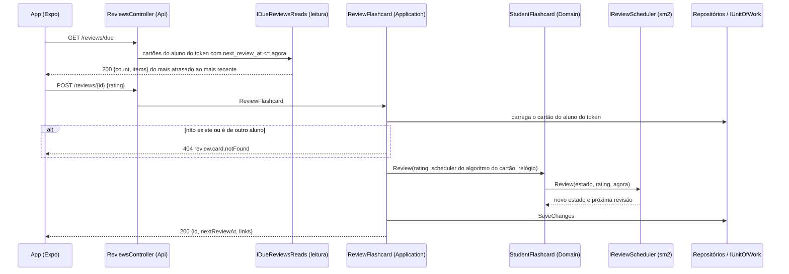
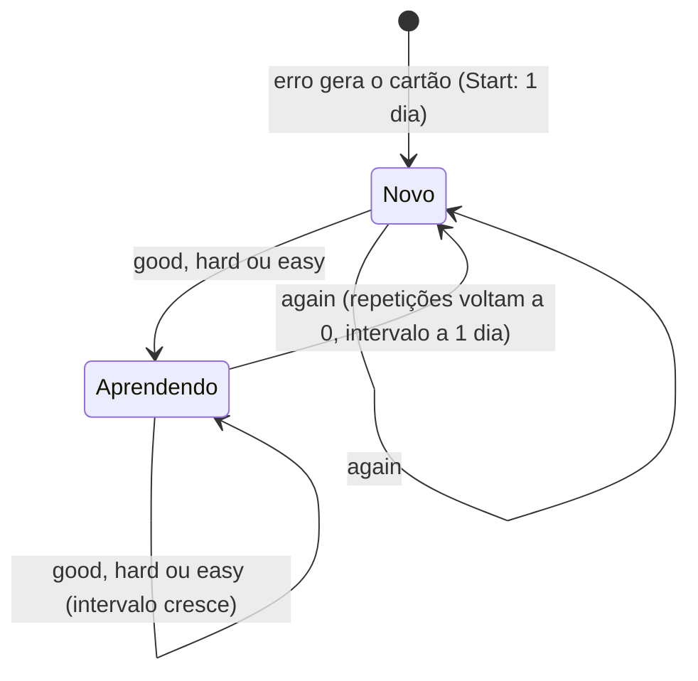
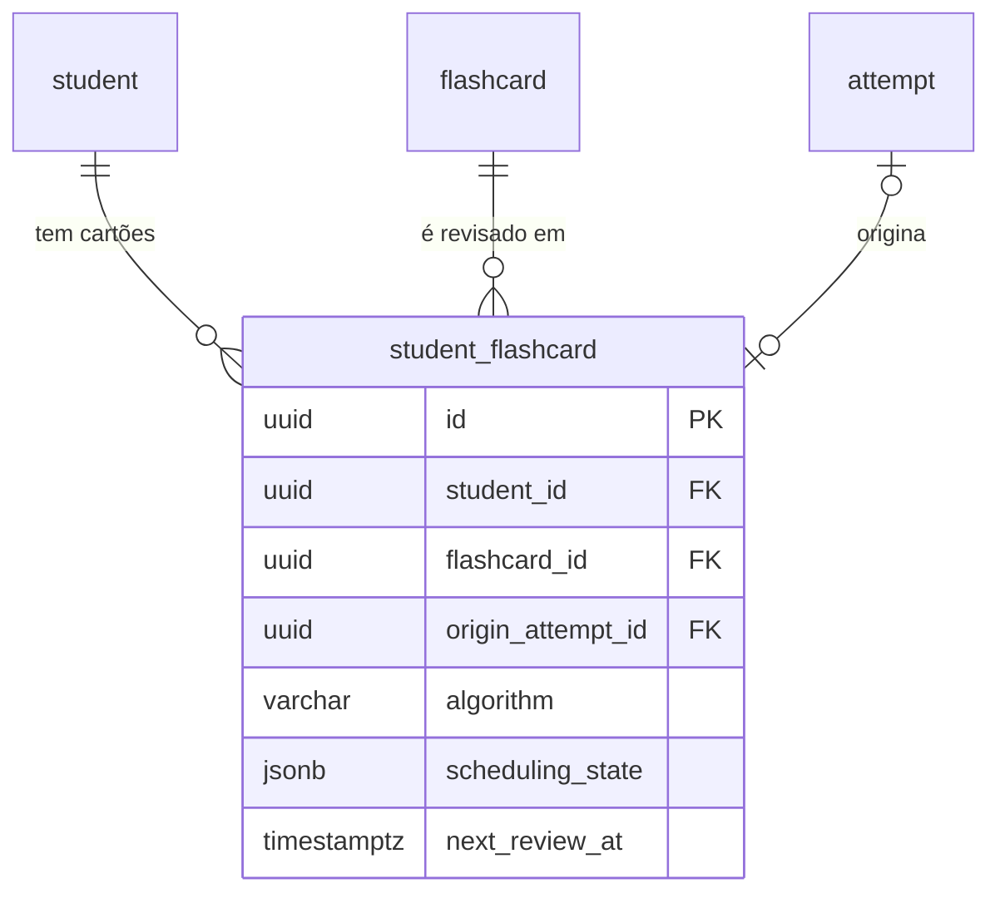

# SRS — Módulo de Revisão Espaçada (Flashcards do Aluno, Revisões do Dia e SM-2)

**Status:** Rascunho. O núcleo já está no Domain e na `main` (#20, PR #76): o port `IReviewScheduler`, o SM-2 (`Sm2Schedule` e `Sm2Scheduler`), o agregado `StudentFlashcard` com a criação e a revisão, e o ADR-003. Faltam a persistência do cartão do aluno (#84) e os endpoints `GET /reviews/due` e `POST /reviews/{id}`, com o caso de uso `ReviewFlashcard` (#89). O contrato está em `docs/api.md` (#82, PR #90). Os requisitos abaixo valem para o módulo completo; a Seção 9 diz o que já existe.

**Pendências de decisão:** PEND-REV-01 e PEND-REV-02 (Seção 7.5).

---

## 1. Introdução

### 1.1 Objetivo do Documento

Especificar os requisitos funcionais, as regras de negócio, os fluxos de exceção e os requisitos não funcionais da **revisão espaçada**: o erro do aluno vira um flashcard que volta para revisão no momento certo, com intervalos que crescem enquanto o aluno acerta e recomeçam quando ele esquece.

É a segunda metade do ciclo central (**errar → diagnosticar → flashcard → revisar → nota → desbloquear**), e o que distingue o Estudarias de um banco de exercícios: o aluno não só vê o erro explicado, ele **revê** o erro quando está prestes a esquecê-lo.

O documento é a referência de aceite do caso de uso `ReviewFlashcard`, dos endpoints de revisão (#89) e da persistência do cartão do aluno (#84).

### 1.2 Escopo

Cobre:

- A **criação** do cartão do aluno, com o primeiro agendamento.
- As **revisões do dia** (`GET /reviews/due`): os cartões vencidos, do mais atrasado ao mais recente.
- A **revisão** de um cartão (`POST /reviews/{studentFlashcardId}`): nota do aluno, novo estado e próxima data.
- O **algoritmo SM-2** e o port que o isola (ADR-003).
- A **persistência** do cartão do aluno.
- O **contador de revisões vencidas** que a trilha mostra.

Não cobre (ver Seção 7):

- Quando o cartão é criado a partir de um erro: é a regra "erro gera flashcard" do módulo [Resposta e Diagnóstico](SRS%20-%20M%C3%B3dulo%20de%20Resposta%20e%20Diagn%C3%B3stico.md), que chama a criação daqui.
- O conteúdo do flashcard (pergunta, resposta, tipo de erro): módulo [Conteúdo](SRS%20-%20M%C3%B3dulo%20de%20Conte%C3%BAdo.md).
- Outro algoritmo além do SM-2 (por exemplo, o FSRS): entra como um adapter novo, em issue própria.
- Notificações e lembretes.
- Histórico de revisões e métricas de retenção.

### 1.3 Definições e Siglas

| Termo | Definição |
|---|---|
| **Flashcard** | O cartão de pergunta e resposta do conteúdo, global por tipo de erro (módulo Conteúdo). |
| **Cartão do aluno (`StudentFlashcard`)** | O estado de revisão de um flashcard **para um aluno**: algoritmo, estado de agendamento e próxima revisão. É o que este módulo cria e atualiza. |
| **Tentativa de origem** | A primeira tentativa do aluno que gerou o cartão. |
| **Port de agendamento (`IReviewScheduler`)** | A interface, no Domain, que cada algoritmo implementa: `Start` e `Review`. |
| **Adapter** | A implementação de um algoritmo (`Sm2Scheduler`). |
| **Estado de agendamento** | O texto (JSON) que o adapter grava e só ele lê. No SM-2: `{"repetitions":0,"intervalDays":1,"easeFactor":2.5}`. |
| **Nota da revisão (`ReviewRating`)** | `again` (errei), `hard`, `good` ou `easy`: neutra ao algoritmo, com 4 níveis. |
| **SM-2** | O algoritmo de repetição espaçada de Wozniak, na forma original. |
| **Repetições** | Quantas revisões corretas seguidas o cartão teve desde o último esquecimento. |
| **Intervalo** | Dias até a próxima revisão. |
| **Fator de facilidade (EF)** | Multiplicador do intervalo: começa em 2,5, nunca desce de 1,3. |
| **Vencido** | O cartão cuja próxima revisão é igual ou anterior ao instante atual. |

### 1.4 Visão Geral do Documento

- **Seção 2**: contexto de negócio, diagrama e atores.
- **Seção 3**: requisitos funcionais (RF-REV-01 a RF-REV-07).
- **Seção 4**: regras de negócio (RN-REV-01 a RN-REV-18).
- **Seção 5**: fluxos alternativos e de exceção (FA-REV-01 a FA-REV-09).
- **Seção 6**: requisitos não funcionais (RNF-REV-01 a RNF-REV-05).
- **Seção 7**: restrições, premissas, o que fica de fora e as decisões pendentes.
- **Seção 8**: modelo de dados e catálogo de erros.
- **Seção 9**: rastreabilidade.

---

## 2. Descrição Geral

### 2.1 Contexto de Negócio

Entender um erro uma vez não basta: sem revisão, o aluno esquece. O Estudarias agenda a revisão do erro **pelo tipo de erro** que o aluno cometeu, no momento em que a curva do esquecimento diz que vale a pena rever. Persona Lucas: estuda no ônibus em blocos de 15 minutos; a tela "N revisões para hoje" cabe nisso.

O diferencial técnico é que o algoritmo é **trocável**: o SM-2 vale agora, mas o FSRS (outro estado, outra escala) pode vir depois. Por isso:

- o agendamento é um **port no Domain**, e cada algoritmo é um **adapter** (ADR-003);
- o estado de agendamento é **opaco**: o agregado o guarda, mas só o adapter o interpreta;
- o cartão fica **preso ao algoritmo** com que nasceu;
- a nota da revisão é **neutra** (4 níveis), e cada adapter a traduz para a sua escala.

Toda a regra fica no servidor: o app não agenda nem calcula intervalo, só mostra os cartões vencidos e envia a nota.

### 2.2 Diagrama de Contexto

### 2.3 Atores

| Ator | Tipo | Descrição |
|---|---|---|
| **Aluno** | Humano | Vê os cartões vencidos, vira, e diz como foi (`again`, `hard`, `good`, `easy`). |
| **App (Expo)** | Sistema | Mostra pergunta e resposta, vira o cartão, oferece 2 ou 4 botões e envia a nota. |
| **`ReviewFlashcard`** | Caso de uso (Application) | Carrega o cartão do aluno, revisa e grava. |
| **Leitura das revisões do dia** | Porta de leitura (Application) | Consulta fechada (ADR-002). |
| **`StudentFlashcard`** | Domain | O agregado: cria e revisa, delegando o cálculo. |
| **`IReviewScheduler`** / **`Sm2Scheduler`** | Port / adapter (Domain) | Calculam o estado e a próxima data. |
| **Composition root** | Api | Registra o scheduler de cada algoritmo. |

---

## 3. Requisitos Funcionais

### RF-REV-01: Criação do cartão do aluno

`StudentFlashcard.Create(aluno, flashcard, tentativaDeOrigem, scheduler, relógio)` cria o cartão com o `algoritmo` do scheduler, o **estado inicial** (`scheduler.Start`) e a primeira revisão agendada. No SM-2, o estado inicial é `{"repetitions":0,"intervalDays":1,"easeFactor":2.5}` e a **primeira revisão é 1 dia depois** da criação (RN-REV-04). Quem decide **quando** criar é o módulo Resposta e Diagnóstico (RF-RSP-06); a unicidade por `(aluno, flashcard)` é do banco (RN-REV-12).

### RF-REV-02: Revisões do dia

**Endpoint:** `GET /reviews/due` (#89). **Porta de leitura:** consulta fechada (ADR-002).

Devolve os cartões do aluno do token com revisão **vencida**, do mais atrasado ao mais recente (RN-REV-10). Cada item: `id` (do cartão do aluno), `question`, `answer`, `topic` (`id` e `name`), `nextReviewAt` e o link `review`. A resposta traz `count` e os links `self` e `trail`. **A resposta vem junto da pergunta**: virar o cartão é coisa do app, para a revisão funcionar sem uma segunda chamada (uma requisição por tela).

### RF-REV-03: Revisar um cartão

**Endpoint:** `POST /reviews/{studentFlashcardId}` (#89). **Caso de uso:** `ReviewFlashcard`.

Recebe `rating` (`again`, `hard`, `good` ou `easy`). Carrega o cartão **do aluno do token** (o de outro aluno é `404`, sem revelar que existe, RN-REV-11), escolhe o scheduler do **algoritmo do cartão** (RN-REV-13), chama `StudentFlashcard.Review` e grava. Responde `200` com `id`, `nextReviewAt` (a nova) e o link `reviews`.

### RF-REV-04: Agendamento pelo port

`IReviewScheduler` tem `Algorithm`, `Start(agora)` e `Review(estado, nota, instanteDaRevisão)`, e devolve um `ReviewOutcome` (estado opaco e próxima revisão). O `StudentFlashcard` só chama o port; nunca interpreta o estado. Detalhes do SM-2 em RN-REV-03 a RN-REV-07.

### RF-REV-05: Contador de revisões vencidas

A trilha traz `dueReviews`: quantos cartões do aluno estão vencidos agora, para o aviso "N revisões para hoje" (módulo Trilha e Progresso, RF-TRL-02). É contado por `next_review_at <= agora`, com o índice `(student_id, next_review_at)`.

### RF-REV-06: Persistência do cartão do aluno (#84)

`StudentFlashcard` é mapeado na tabela `student_flashcard`, com `algorithm`, `scheduling_state` (`jsonb`) e `next_review_at` como colunas próprias, o índice único `(student_id, flashcard_id)` e o índice `(student_id, next_review_at)` das revisões do dia (ADR-003). Um repositório de escrita (`IStudentFlashcardRepository`) carrega e grava o agregado.

### RF-REV-07: Escolha do algoritmo no composition root

O `Sm2Scheduler` é registrado como o scheduler do algoritmo `sm2`. O caso de uso escolhe o scheduler **pelo algoritmo gravado no cartão**, e os cartões **novos** usam o algoritmo ativo, definido no composition root. Um cartão de algoritmo **sem scheduler registrado** é erro de configuração (RN-REV-13).

---

## 4. Regras de Negócio

### RN-REV-01: O cartão fica preso ao algoritmo com que nasceu

O agregado guarda o nome do algoritmo. Revisar com um scheduler de **outro** algoritmo é erro (`studentFlashcard.scheduler.mismatch`): um adapter nunca lê um estado que não escreveu.

### RN-REV-02: O estado de agendamento é opaco

O agregado guarda o estado como texto e não o interpreta; só o adapter o escreve e o lê. Trocar de algoritmo é um adapter novo, **sem mexer no `StudentFlashcard` nem no schema** (ADR-003). Como migrar os cartões existentes (reiniciar ou converter o estado) é decisão da issue do adapter novo.

### RN-REV-03: A nota é neutra, de 4 níveis

A nota que o app envia é `again`, `hard`, `good` ou `easy`, o denominador comum entre algoritmos, que também deixa o app oferecer só dois botões (`again` e `good`) ou os quatro. O adapter do SM-2 a traduz para a nota original: **`again` = 1, `hard` = 3, `good` = 4, `easy` = 5**. Uma nota fora do enum falha com `studentFlashcard.rating.invalid`.

### RN-REV-04: O SM-2 original, estado inicial

Fator de facilidade inicial **2,5**, mínimo **1,3**; estado inicial: **0 repetições, intervalo de 1 dia**. O cartão novo é agendado para **1 dia depois** da criação.

### RN-REV-05: O intervalo do SM-2

Numa revisão **correta** (nota 3 ou mais):

| Repetições antes | Novo intervalo |
|---|---|
| 0 | 1 dia |
| 1 | 6 dias |
| 2 ou mais | intervalo anterior × fator de facilidade, arredondado (meio para longe de zero) |

e as repetições aumentam em 1. Seguindo a fórmula à risca: a primeira revisão correta mantém 1 dia e a segunda leva a 6.

Exemplo, só com `good` (fator se mantém em 2,5): 1, 6, 15 (6 × 2,5), 38 (15 × 2,5 = 37,5), …

### RN-REV-06: O fator de facilidade

Numa revisão correta, `EF' = EF + (0,1 − (5 − q) × (0,08 + (5 − q) × 0,02))`, onde `q` é a nota do SM-2, com **2 casas** e nunca abaixo de **1,3**:

| Nota do aluno | `q` | Efeito no fator |
|---|---|---|
| `easy` | 5 | +0,10 |
| `good` | 4 | 0 (mantém) |
| `hard` | 3 | −0,14 |

`hard` ainda é **acerto**: avança o intervalo, mas reduz o fator, então as revisões seguintes espaçam menos.

### RN-REV-07: Esquecer reinicia

Com nota abaixo de 3 (`again`, `q` = 1), as repetições voltam a **0** e o intervalo a **1 dia**: o cartão recomeça. O fator de facilidade **não muda** nesse caso.

### RN-REV-08: A próxima revisão parte do instante real da revisão

A data nova é o instante em que o aluno revisou **mais** o intervalo, e não a data agendada. Quem revisa atrasado não "ganha" o atraso de volta, e quem revisa adiantado não perde dias.

### RN-REV-09: Vencido, link e revisão antecipada

O cartão está **vencido** quando `next_review_at <= agora`. A lista do dia traz só os vencidos, e o link `review` só aparece neles (os links só aparecem quando a ação é permitida). **Revisar antes do vencimento é aceito** pelo Domain e pelo endpoint: a oferta da revisão só no vencimento é regra da API, não do agregado.

### RN-REV-10: Ordem das revisões

Do **mais atrasado** (menor `next_review_at`) para o mais recente, com desempate estável entre as chamadas. O que está atrasado há mais tempo é o que o aluno mais está prestes a esquecer.

### RN-REV-11: O cartão é do aluno do token

`ReviewFlashcard` carrega o cartão **do aluno do token**. Um cartão de **outro** aluno responde `404 review.card.notFound`, exatamente como um que não existe, sem revelar que ele existe. Nenhuma rota recebe id de aluno.

### RN-REV-12: Um cartão por aluno e flashcard

O índice único `(student_id, flashcard_id)` garante que o aluno tem no máximo um cartão por flashcard. Errar de novo o mesmo tipo de erro **não** cria outro cartão nem reinicia o agendamento (módulo Resposta e Diagnóstico, RN-RSP-10).

### RN-REV-13: Um scheduler por algoritmo, e a falta de um é erro de configuração

O composition root registra o scheduler de cada algoritmo (`sm2`). Um cartão cujo algoritmo não tem scheduler registrado é **erro de configuração** (erro do servidor), não "cartão inválido" nem erro do aluno.

### RN-REV-14: Estado ilegível é dado corrompido

Um estado de agendamento vazio, que não é JSON, ou com valores inválidos (repetições negativas, intervalo menor que 1, fator abaixo de 1,3) lança `InvalidOperationException`: é defeito de dados, **erro do servidor**, e não vira erro de validação para o aluno.

### RN-REV-15: O schema guarda só o estado atual

Não há histórico de revisões: cada revisão sobrescreve o estado e a data. Se a análise do experimento precisar do histórico (por exemplo, para medir retenção), é uma tabela e um agregado novos (ADR-003, "revisitar quando").

### RN-REV-16: A revisão é uma gravação só

`ReviewFlashcard` carrega, revisa e grava na `IUnitOfWork`, que persiste o estado novo e a próxima revisão juntos. Nenhum efeito além do cartão: a revisão **não** altera a nota do tópico nem o desbloqueio (RN-REV-18).

### RN-REV-17: O cartão nos dois grupos experimentais (pendente)

**Proposta:** os dois grupos revisam os cartões do mesmo jeito, e o cartão existe para os dois. Ver PEND-REV-01 (e PEND-RSP-01 no módulo Resposta e Diagnóstico).

### RN-REV-18: A revisão do cartão não muda a nota

A nota do tópico depende só das respostas a exercícios (módulo Trilha e Progresso, RN-TRL-01). Rever um cartão não é uma tentativa e não entra na nota, no domínio nem no desbloqueio. Revisar é para **reter**; o domínio mede o **desempenho em exercícios**.

---

## 5. Fluxos Alternativos e de Exceção

### FA-REV-01: Sem revisões vencidas

`200` com `count: 0` e `items: []`. A tela mostra "nada para revisar hoje". Um aluno sem nenhum cartão recebe a mesma resposta.

### FA-REV-02: Revisão antes do vencimento

Aceita. O estado avança e a próxima revisão parte do instante da revisão (RN-REV-08, RN-REV-09). O cartão não vencido não aparece em `GET /reviews/due`, então o app só chega aqui por um link antigo ou por repetição do pedido.

### FA-REV-03: Nota inválida

`400 studentFlashcard.rating.invalid` para um `rating` desconhecido ou ausente. Nada é gravado.

### FA-REV-04: Cartão inexistente ou de outro aluno

`404 review.card.notFound`, igual nos dois casos (RN-REV-11).

### FA-REV-05: Scheduler de outro algoritmo

`studentFlashcard.scheduler.mismatch`. Com o scheduler escolhido pelo algoritmo do cartão (RF-REV-07), esse caminho não deveria ocorrer; se ocorrer, é defeito de configuração.

### FA-REV-06: Algoritmo sem scheduler registrado

Erro do servidor (RN-REV-13), sem detalhe técnico para o cliente.

### FA-REV-07: Estado de agendamento corrompido

Erro do servidor (`InvalidOperationException`, RN-REV-14), sem detalhe técnico para o cliente. O cartão não é gravado.

### FA-REV-08: Duas revisões simultâneas do mesmo cartão

O contrato não diz o que acontece (PEND-REV-02): duas revisões que leem o mesmo estado e gravam podem fazer uma delas ser perdida. A forma exata (token de concorrência, ou aceitar a última) é definida na #89.

### FA-REV-09: Requisição sem token

`401`, como em todo endpoint protegido (módulo Autenticação, RF-09).

---

## 6. Requisitos Não Funcionais

### RNF-REV-01: Trocar o algoritmo é um adapter

Nenhum outro arquivo muda para entrar um segundo algoritmo: o agregado, o schema e os dados gravados ficam como estão (RN-REV-02). É o requisito de arquitetura do módulo.

### RNF-REV-02: Cálculo determinístico e testável

O SM-2 é uma função pura do estado, da nota e do instante, em `decimal` com 2 casas, sem I/O. Os testes controlam o tempo (`TimeProvider`, `FakeTimeProvider`) e não dependem do relógio real.

### RNF-REV-03: Consulta das revisões do dia barata

`GET /reviews/due` e o contador da trilha usam o índice `(student_id, next_review_at)`: é por essa coluna, e não pelo `jsonb`, que as revisões do dia são buscadas, e é por isso que ela é coluna própria (ADR-003).

### RNF-REV-04: Consistência

A revisão é gravada numa unidade de trabalho; a unicidade `(student_id, flashcard_id)` e o `jsonb` válido ficam no banco e no adapter (RN-REV-12, RN-REV-14).

### RNF-REV-05: Testabilidade contra o PostgreSQL real

O estado `jsonb` do SM-2 é lido de volta igual, a unicidade e os índices são recusados ou usados pelo banco real, e a leitura das revisões do dia confere só vencidos, na ordem (`docs/testing.md`). O ciclo é coberto por HTTP: revisar reagenda, cartão de outro aluno dá `404`, nota inválida dá `400`.

---

## 7. Restrições, Premissas e o que Fica de Fora

### 7.1 Restrições técnicas

- .NET 10, Clean Architecture em quatro projetos; o port e o adapter do SM-2 ficam no **Domain** (lógica pura). Um adapter futuro que precise de biblioteca, parâmetros ajustados ou I/O pode morar na Infrastructure.
- PostgreSQL com EF Core; tabelas e colunas em inglês, em snake_case e no singular; `scheduling_state` em `jsonb`.
- Datas em UTC, ids GUID v7, enums em minúsculas.

### 7.2 Premissas

- **P-REV-01**: o relógio do servidor é a fonte do tempo (`TimeProvider`), em UTC.
- **P-REV-02**: existe um flashcard gerado por tipo de erro no conteúdo carregado (módulo Conteúdo; ver PEND-RSP-02).
- **P-REV-03**: o app mostra a pergunta e a resposta e é quem vira o cartão; o servidor não rastreia "viu a resposta".

### 7.3 Configuração

Sem variável nova. O algoritmo ativo para cartões novos é definido no composition root (`sm2`).

### 7.4 Fora do escopo

- FSRS e qualquer algoritmo além do SM-2 (um adapter novo, em issue própria).
- Histórico de revisões e métricas de retenção.
- Notificações, lembretes e "meta diária".
- Cartões manuais criados pelo aluno ou por professor.
- Suspender, adiar ou apagar um cartão.
- Limite de cartões novos ou de revisões por dia.

### 7.5 Decisões pendentes

| Id | Pendência | Proposta atual |
|---|---|---|
| **PEND-REV-01** | **O cartão no grupo controle** (a mesma de PEND-RSP-01): a pergunta do cartão revela o diagnóstico. | Criar o cartão nos dois grupos e registrar a decisão num ADR, antes da #88. |
| **PEND-REV-02** | **Revisões simultâneas do mesmo cartão.** O contrato e o Domain não dizem o que acontece quando duas revisões chegam juntas. | Decidir na #89 entre um token de concorrência (a segunda recebe erro) e aceitar a última gravação. O risco real é pequeno (um aluno, um aparelho), mas o app reenvia a requisição ao renovar a sessão. |

---

## 8. Modelo de Dados

### 8.1 Diagrama

### 8.2 Tabelas

**`student_flashcard`** (#84)

| Coluna | Tipo | Observação |
|---|---|---|
| `id` | uuid PK | É o `studentFlashcardId` da API |
| `student_id` | uuid NOT NULL, FK `student` | |
| `flashcard_id` | uuid NOT NULL, FK `flashcard` | |
| `origin_attempt_id` | uuid, FK `attempt`, nulo | A primeira tentativa que gerou o cartão para o aluno |
| `algorithm` | varchar NOT NULL | Ex.: `sm2`; o cartão fica preso a ele (RN-REV-01) |
| `scheduling_state` | jsonb NOT NULL | Opaco para o Domain; só o adapter o lê e escreve (RN-REV-02) |
| `next_review_at` | timestamptz NOT NULL | Coluna própria e indexada: é por ela que as revisões do dia são buscadas |

Índices: único `(student_id, flashcard_id)` (RN-REV-12) e `(student_id, next_review_at)` (RNF-REV-03). O estado inicial do SM-2 é `{"repetitions":0,"intervalDays":1,"easeFactor":2.5}`.

### 8.3 Catálogo de erros

| Código | Quando | Resposta HTTP |
|---|---|---|
| `review.card.notFound` | Cartão que não existe, ou que é de outro aluno | 404 |
| `studentFlashcard.rating.invalid` | Nota da revisão desconhecida ou ausente | 400 |
| `studentFlashcard.scheduler.mismatch` | Scheduler de outro algoritmo: defeito de configuração, não provocável pelo cliente | 400 (exceção de validação do Domain) |
| `studentFlashcard.student.required`, `studentFlashcard.flashcard.required`, `studentFlashcard.originAttempt.invalid` | Defeito interno: o caso de uso monta o cartão com ids que sempre existem | 400 (exceção de validação do Domain) |
| *(sem `code`)* | Estado de agendamento ilegível, ou algoritmo sem scheduler registrado | 500 |

`401` sem token válido, sem `code`.

---

## 9. Rastreabilidade

| Requisito | Implementação | Testes |
|---|---|---|
| RF-REV-04, RN-REV-01 | Domain: #21 (PR #76) | `Sm2SchedulerTests` |
| RN-REV-03 a RN-REV-07, RNF-REV-02 | Domain: #21 (PR #76) | `Sm2ScheduleTests`; `Sm2SchedulerTests` |
| RF-REV-01, RN-REV-04 (criação), RN-REV-12 (construção) | Domain: #22 (PR #76) | `StudentFlashcardTests` |
| RN-REV-01, RN-REV-08, RN-REV-09 (`IsDue`), RN-REV-03 (nota inválida) | Domain: #23 (PR #76) | `StudentFlashcardReviewTests` |
| RN-REV-02, RN-REV-14, RNF-REV-01 | ADR-003 (PR #76); Domain | `Sm2SchedulerTests`; `StudentFlashcardReviewTests` |
| RF-REV-06, RN-REV-12, RN-REV-15, RNF-REV-04 | #84 (a fazer) | Integração: cartão vai e volta; o estado `jsonb` do SM-2 é lido de volta igual; as restrições são recusadas pelo banco |
| RF-REV-02, RN-REV-09, RN-REV-10, RF-REV-05, FA-REV-01, RNF-REV-03 | #89 (a fazer) | Integração da leitura (só vencidos, ordem) |
| RF-REV-03, RF-REV-07, RN-REV-11, RN-REV-13, RN-REV-16, RN-REV-18, FA-REV-02 a FA-REV-08 | #89 (a fazer) | Unidade do caso de uso; funcionais por HTTP (revisar reagenda; cartão de outro aluno dá `404`; nota inválida dá `400`) |
| RN-REV-17, PEND-REV-01 | ADR a escrever antes da #88 | — |
| Contrato dos endpoints | #82 (PR #90) | Revisão do `docs/api.md` |

---

*Documento gerado em 17-11-2026, referente às issues #84 e #89 e às regras já entregues no Domain (#20 a #23, ADR-003). Os requisitos valem para o módulo completo. As pendências da Seção 7.5 serão revistas e removidas daqui quando decididas.*
