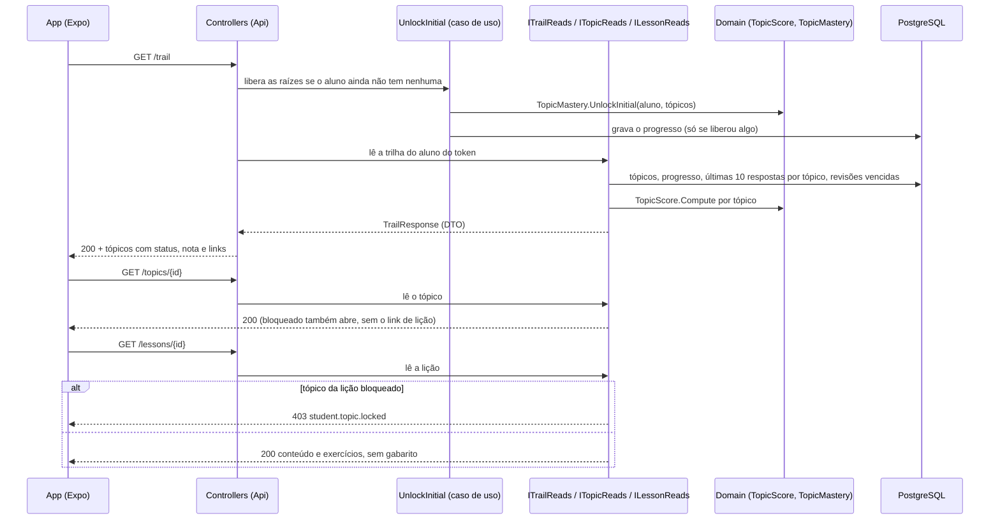
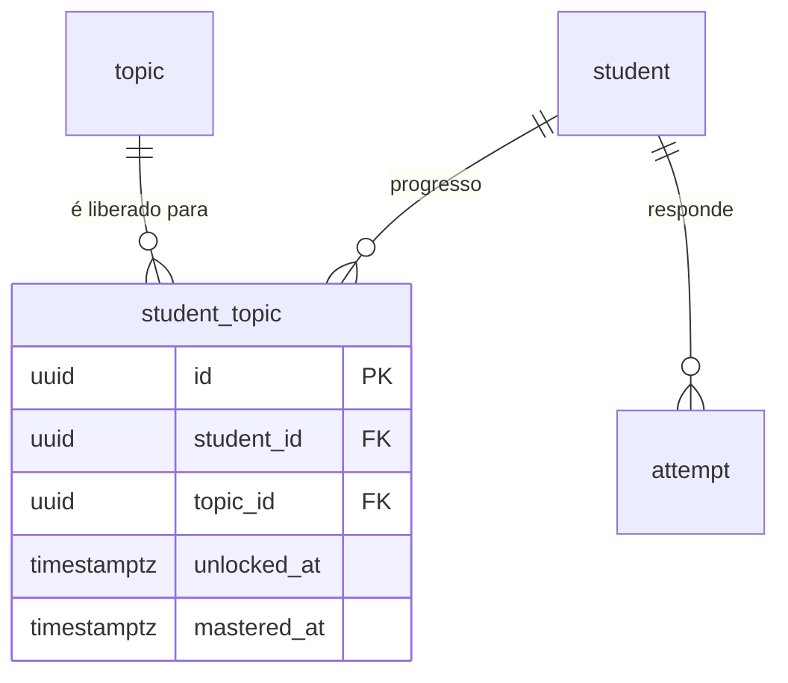

# SRS — Módulo de Trilha e Progresso (Trilha, Tópico, Lição, Nota, Domínio e Desbloqueio)

**Status:** Em implementação. As regras puras já estão no Domain e na `main`: a nota do tópico (#70) e o domínio e desbloqueio (#71, PR #77), além do `Student` com o progresso por tópico (#14, PR #15). O contrato das leituras está em `docs/api.md` (#82, PR #90). A persistência do progresso (#84) está implementada (tabela `student_topic`, Seção 8.2). Faltam os endpoints `GET /trail` (#86), `GET /topics/{id}` e `GET /lessons/{id}` (#87), a regra e o estado da lição (#91) e o histórico de respostas (#92). Os requisitos abaixo valem para o módulo completo; a Seção 9 diz o que já existe.

**Pendência de decisão:** PEND-TRL-01 (Seção 7.5).

---

## 1. Introdução

### 1.1 Objetivo do Documento

Especificar os requisitos funcionais, as regras de negócio, os fluxos de exceção e os requisitos não funcionais do módulo que mostra ao aluno **onde ele está**: a trilha de tópicos, o tópico com a nota e o que falta, a lição com seus exercícios, e as regras que decidem a nota, o domínio, o desbloqueio e o estado de cada lição.

O documento é a referência de aceite dos endpoints de leitura (#86, #87, #92), da regra de lição (#91) e da persistência do progresso (#84).

### 1.2 Escopo

Cobre:

- **Liberação inicial** dos tópicos-raiz para o aluno novo.
- **Trilha** (`GET /trail`): os tópicos em ordem de pré-requisito, com status, nota e o contador de revisões vencidas.
- **Tópico** (`GET /topics/{topicId}`): nota, tentativas, meta, pré-requisitos, o que ele libera e as lições.
- **Lição** (`GET /lessons/{lessonId}`): conteúdo e exercícios **sem gabarito**.
- **Histórico de respostas do tópico** (`GET /topics/{topicId}/attempts`): as respostas que compõem a nota.
- **Nota do tópico**, **domínio** e **desbloqueio dos dependentes** (as regras do Domain).
- **Estado da lição** (`notStarted`, `inProgress`, `completed`) e o progresso de lições.
- **Links** de ação por estado (#8).
- **Persistência do progresso** por tópico.

Não cobre (ver Seção 7):

- Gravar a resposta e recalcular a nota e o desbloqueio: o módulo [Resposta e Diagnóstico](SRS%20-%20M%C3%B3dulo%20de%20Resposta%20e%20Diagn%C3%B3stico.md) chama as regras daqui, e o resultado volta na resposta dele.
- A criação, o agendamento e a revisão dos cartões (módulo [Revisão Espaçada](SRS%20-%20M%C3%B3dulo%20de%20Revis%C3%A3o%20Espa%C3%A7ada.md)); aqui só se conta o que venceu.
- O conteúdo em si (módulo [Conteúdo](SRS%20-%20M%C3%B3dulo%20de%20Conte%C3%BAdo.md)).
- Parâmetros configuráveis da nota e do domínio.

### 1.3 Definições e Siglas

| Termo | Definição |
|---|---|
| **Nota do tópico (`TopicScore`)** | Número de 0 a 100: média das últimas respostas do aluno no tópico, ponderada pela dificuldade e pela recência. |
| **Janela** | As últimas 10 respostas do aluno no tópico: só elas entram na nota. |
| **Decaimento** | Fator 0,9 aplicado a cada resposta mais antiga da janela: a mais recente pesa 1, a seguinte 0,9, depois 0,81 e assim por diante. |
| **Peso da dificuldade** | `easy` 1, `medium` 2, `hard` 3. |
| **Meta (`masteryThreshold`)** | A nota mínima para dominar o tópico: 70. |
| **Mínimo de tentativas (`minAttempts`)** | O número mínimo de tentativas no tópico para dominá-lo: 5. |
| **Status do tópico** | `locked` (sem progresso gravado), `available` (liberado, ainda não dominado) ou `mastered` (dominado). |
| **Domínio** | O tópico passa a `mastered` quando a nota é de pelo menos a meta **e** as tentativas são de pelo menos o mínimo. |
| **Liberação inicial** | A liberação dos tópicos sem pré-requisito para o aluno que ainda não tem nenhum. |
| **Estado da lição** | `notStarted`, `inProgress` ou `completed`, derivado das tentativas do aluno nos exercícios da lição. |
| **Gabarito** | A indicação de qual alternativa é a correta. Nunca sai nas leituras. |
| **Link** | Ação permitida no estado atual do recurso: `{ href, rel, method }` (#8). |
| **Porta de leitura (`*Reads`)** | Consulta fechada na Application que devolve um DTO, sem caso de uso nem repositório (ADR-002). |

### 1.4 Visão Geral do Documento

- **Seção 2**: contexto de negócio, diagrama e atores.
- **Seção 3**: requisitos funcionais (RF-TRL-01 a RF-TRL-10).
- **Seção 4**: regras de negócio (RN-TRL-01 a RN-TRL-18).
- **Seção 5**: fluxos alternativos e de exceção (FA-TRL-01 a FA-TRL-11).
- **Seção 6**: requisitos não funcionais (RNF-TRL-01 a RNF-TRL-06).
- **Seção 7**: restrições, premissas, o que fica de fora e as decisões pendentes.
- **Seção 8**: modelo de dados e catálogo de erros.
- **Seção 9**: rastreabilidade.

---

## 2. Descrição Geral

### 2.1 Contexto de Negócio

O Estudarias é uma plataforma de estudo **adaptativa**: o aluno não escolhe o caminho, a trilha escolhe. Um tópico novo só abre quando os pré-requisitos estão dominados, e dominar exige uma nota que reflete o desempenho **recente** e uma quantidade mínima de prática, para que um acerto de sorte não libere o próximo assunto e um erro antigo não prenda o aluno para sempre.

Toda essa regra fica no servidor. O app é um cliente fino (personas: Ana, com Android básico e plano pré-pago, e Lucas, que estuda no ônibus em blocos de 15 minutos): **uma requisição por tela**, sem calcular nota, desbloqueio nem estado, e decidindo quais botões mostrar pelos **links** de cada recurso.

Por isso o módulo:

- calcula a nota, o domínio e o desbloqueio no Domain, como lógica pura e testada, sem I/O;
- serve as telas por **leituras fechadas** (ADR-002), cada uma com tudo que a tela precisa;
- deixa o tópico bloqueado **abrir** para o aluno ver o que falta, mas não deixa praticar;
- nunca expõe o gabarito antes de o aluno responder.

### 2.2 Diagrama de Contexto

### 2.3 Atores

| Ator | Tipo | Descrição |
|---|---|---|
| **Aluno** | Humano | Abre a trilha, o tópico e a lição, e estuda. |
| **App (Expo)** | Sistema | Mostra o que a API devolve; decide botões pelos links. |
| **`UnlockInitial`** | Caso de uso (Application) | Libera as raízes: é escrita, então passa por um caso de uso antes da leitura. |
| **`ITrailReads`**, **`ITopicReads`**, **`ILessonReads`**, **`ITopicAttemptsReads`** | Portas de leitura (Application) | Consultas fechadas, projetadas direto para o DTO. Só `ITrailReads` tem nome nas issues; os outros são provisórios e se fixam na implementação. |
| **`TopicScore`** | Domain | Calcula a nota. |
| **`TopicMastery`** | Domain | Decide o domínio e libera os dependentes. |
| **`LessonProgress`** | Domain | Calcula o estado da lição (#91). |
| **`Student` / `TopicProgress`** | Domain | Guardam o progresso: desbloqueio e domínio, com as datas. |

---

## 3. Requisitos Funcionais

### RF-TRL-01: Liberação inicial

**Caso de uso:** `UnlockInitial` (#86), chamado no cadastro (`RegisterStudent`) e ao abrir a trilha.

Libera, para o aluno, os tópicos sem pré-requisito (`TopicMastery.UnlockInitial`), gravando o progresso de cada um. É **idempotente** (RN-TRL-07) e só grava se algo foi liberado. Roda também ao abrir a trilha, para quem se cadastrou **antes** de existir conteúdo (FA-TRL-02).

### RF-TRL-02: Trilha

**Endpoint:** `GET /trail` (#86). **Porta de leitura:** `ITrailReads`.

Devolve, para o aluno do token: `masteryThreshold`, `masteredTopics`, `totalTopics`, `dueReviews` e a lista `topics` em ordem de pré-requisito (RN-TRL-16), cada um com `id`, `slug`, `name`, `status`, `score` (nulo sem respostas), `prerequisites` (ids), `completedLessons` e `totalLessons` (#91) e os links. Serve a tela da trilha (lista) e a do mapa (grafo, pelos `prerequisites`). `dueReviews` é a contagem de cartões com `next_review_at` vencido (módulo Revisão Espaçada).

### RF-TRL-03: Tópico

**Endpoint:** `GET /topics/{topicId}` (#87). **Porta de leitura:** `ITopicReads`.

Devolve: status, nota, `attemptCount`, meta e mínimo de tentativas, `prerequisites` (com o status de cada um para o aluno), `unlocks` (os tópicos que têm este como pré-requisito) e `lessons` (com `order`, título, `status`, `completedExercises` e `totalExercises`, #91). Um tópico **bloqueado também abre** (`200`): a tela mostra o que falta, e as lições vêm **sem o link `lesson`** (RN-TRL-08).

### RF-TRL-04: Lição

**Endpoint:** `GET /lessons/{lessonId}` (#87). **Porta de leitura:** `ILessonReads`.

Devolve o conteúdo e os exercícios da lição, com as alternativas na ordem do conteúdo e **sem nenhum campo que revele a correta** (RN-TRL-11). Cada exercício traz o link `answer`. Lição de tópico bloqueado responde `403 student.topic.locked` (FA-TRL-05).

### RF-TRL-05: Nota do tópico

`TopicScore.Compute` recebe as respostas do aluno no tópico, da mais recente para a mais antiga, e devolve a nota de 0 a 100 (RN-TRL-01). É lógica pura: a leitura e o caso de uso de resposta a chamam, e **nenhum deles grava a nota** (RN-TRL-03).

### RF-TRL-06: Domínio e desbloqueio

`TopicMastery.Evaluate` marca o tópico como dominado quando a nota e as tentativas bastam (RN-TRL-04) e libera os dependentes cujos pré-requisitos estão **todos** dominados (RN-TRL-06). Devolve só os tópicos liberados naquela chamada. É chamado pelo módulo Resposta e Diagnóstico a cada resposta.

### RF-TRL-07: Estado da lição (#91)

`LessonProgress.Of(exerciseIds, attemptedExerciseIds, correctlyAnsweredExerciseIds)` devolve o estado (`notStarted`, `inProgress`, `completed`) e a contagem de exercícios acertados e totais (RN-TRL-12). As leituras da trilha (`completedLessons` e `totalLessons`) e do tópico (estado de cada lição) usam esse cálculo, e a resposta de `POST /exercises/{id}/attempts` traz o estado novo da lição (módulo Resposta e Diagnóstico).

### RF-TRL-08: Histórico de respostas do tópico (#92)

**Endpoint:** `GET /topics/{topicId}/attempts`. **Porta de leitura:** `ITopicAttemptsReads`.

Devolve as respostas do aluno do token **no tópico que entram na nota** (a janela das últimas 10), da mais recente para a mais antiga. Cada item: `attemptId`, `exerciseId`, `statement`, `difficulty`, `isCorrect`, `answeredAt`. Serve ao app para mostrar o histórico que compõe a nota. Tópico bloqueado responde `403 student.topic.locked`; tópico inexistente, `404 trail.topic.notFound` (FA-TRL-07).

### RF-TRL-09: Links por estado

Todo recurso traz `links`; uma ação só aparece quando é permitida (RN-TRL-09). Montados só na API, com rotas nomeadas e `Url.Link` (formato `Link(Href, Rel, Method)` da #8):

| `rel` | Onde | Quando |
|---|---|---|
| `self` | todo recurso | sempre |
| `trail` | tópico | sempre |
| `topic` | item da trilha, tópico | sempre |
| `lesson` | item de lição | só se o tópico não está bloqueado |
| `answer` | exercício | só se o tópico não está bloqueado |
| `reviews` | trilha | sempre |

### RF-TRL-10: Persistência do progresso (#84)

`Student.Progress` (`TopicProgress`) é mapeado na tabela `student_topic`: uma linha **só a partir do desbloqueio**, com `unlocked_at` e `mastered_at` (nulo enquanto disponível), e índice único `(student_id, topic_id)`. `IStudentRepository.FindAsync` carrega o aluno com o progresso, rastreado para a escrita. O progresso é mapeado como coleção do agregado (*owned*): vem junto com o aluno, sem `Include`, e um desbloqueio ou domínio feito no aluno carregado é gravado pela `IUnitOfWork`.

---

## 4. Regras de Negócio

### RN-TRL-01: A nota do tópico

Dada a lista de respostas da mais recente para a mais antiga, só as **10 primeiras** entram. A resposta na posição `p` (começando em 0) tem peso `dificuldade × 0,9^p`, com dificuldade `easy` = 1, `medium` = 2 e `hard` = 3. A nota é `100 × (soma dos pesos das corretas) ÷ (soma de todos os pesos)`. Sem nenhuma resposta, a nota é 0.

Exemplo: três respostas, da mais recente à mais antiga, `medium` errada, `easy` certa, `easy` certa → pesos 2, 0,9 e 0,81; ganho 1,71 de 3,71; nota 46,09.

### RN-TRL-02: A nota exibida tem uma casa, arredondada para baixo

A API devolve a nota com **uma casa decimal, sempre para baixo**: 69,9997 vira `69.9`, nunca `70.0`. Assim a nota exibida nunca parece ter atingido a meta sem ter atingido (FA-TRL-09).

### RN-TRL-03: A nota é calculada na leitura, nunca gravada

A nota deriva das tentativas já gravadas (as últimas 10 do aluno no tópico). Não há coluna de nota: não há o que sincronizar nem migrar se a fórmula mudar. Sem nenhuma resposta no tópico, a API devolve `score: null`, não 0.

### RN-TRL-04: Domínio do tópico

O tópico é dominado quando **nota ≥ 70 e tentativas ≥ 5**. Os dois parâmetros são constantes do Domain (`TopicMastery.Threshold` e `TopicMastery.MinAttempts`); a API os devolve em `masteryThreshold` e `minAttempts` para a tela mostrar a meta. A condição é avaliada a cada resposta (módulo Resposta e Diagnóstico).

### RN-TRL-05: Nada volta atrás

Um tópico liberado **nunca** volta a bloqueado, e um tópico dominado **nunca** deixa de ser dominado: a primeira data de domínio é mantida (`MasteredAt ??= agora`), mesmo que a nota caia depois. O aluno de um tópico dominado pode continuar praticando; as respostas continuam sendo gravadas e a nota continua sendo calculada, sem rebaixar o status.

### RN-TRL-06: Os dependentes só abrem com todos os pré-requisitos dominados

Ao dominar um tópico, o motor olha os tópicos que o têm como pré-requisito e libera cada um cujo status é `locked` **e** cujos pré-requisitos estão **todos** `mastered`. Um dependente que ainda tem pré-requisito por dominar continua bloqueado. Só os liberados naquela chamada são devolvidos, para o aviso de desbloqueio.

### RN-TRL-07: A liberação inicial é idempotente

`UnlockInitial` só libera o tópico-raiz que ainda está `locked` e devolve só os liberados naquela chamada. Chamar de novo, no cadastro e depois na trilha, não duplica progresso nem muda datas.

### RN-TRL-08: O tópico bloqueado abre, mas não se pratica

O tópico bloqueado responde `200` em `GET /topics/{id}`, para a tela mostrar os pré-requisitos que faltam, mas as lições vêm sem o link `lesson`. Abrir a lição (`GET /lessons/{id}`), responder um exercício dele e pedir o histórico respondem `403 student.topic.locked`.

### RN-TRL-09: Uma ação só aparece quando é permitida

O app mostra um botão se, e somente se, o link existe. Quem calcula "pode?" é o servidor, ao montar os links (RF-TRL-09): a Application devolve o estado, e a API o transforma em links. Domain e Application não conhecem URL.

### RN-TRL-10: Leitura não passa por caso de uso

As leituras (trilha, tópico, lição, histórico) são portas `*Reads` que devolvem DTOs por projeção, sem carregar agregado e sem rastreamento (ADR-002). A **única** escrita do módulo é a liberação inicial, e por isso ela passa por um caso de uso (`UnlockInitial`) **antes** da leitura da trilha.

### RN-TRL-11: A lição nunca revela o gabarito

Nenhum campo de `GET /lessons/{id}` diz qual alternativa é a correta: nem um booleano, nem o tipo de erro, nem a ordem. O DTO da alternativa só tem `id` e `text`. A correta só é revelada **depois** de o aluno responder (módulo Resposta e Diagnóstico).

### RN-TRL-12: Os três estados da lição

Calculados das tentativas do aluno nos exercícios **da lição**:

| Estado | Quando |
|---|---|
| `notStarted` | nenhuma tentativa em nenhum exercício da lição |
| `inProgress` | pelo menos uma tentativa, mas ainda há exercício que o aluno nunca acertou |
| `completed` | o aluno acertou **cada** exercício da lição pelo menos uma vez, em qualquer tentativa |

`completedExercises` conta os exercícios da lição acertados pelo menos uma vez; ids de exercícios que não são da lição são ignorados. Uma lição **sem exercícios** é `notStarted`, com 0 de 0: não conta como concluída.

### RN-TRL-13: O estado da lição é derivado, sem estado novo

Sai das tentativas que já são gravadas, sem tabela nem coluna. Consequências: **errar depois um exercício já acertado não desfaz a conclusão**, e se a carga do conteúdo acrescentar um exercício a uma lição concluída, ela volta a `inProgress` até o aluno acertá-lo (há conteúdo novo para ver).

### RN-TRL-14: Lição concluída não é domínio

A lição concluída mostra que o aluno passou por todo o conteúdo; **quem libera a trilha continua sendo a nota do tópico** (RN-TRL-04). Uma lição pode estar concluída com o tópico abaixo de 70, e o tópico pode ficar dominado antes de todas as lições estarem concluídas. As duas metas aparecem separadas na tela.

### RN-TRL-15: Os dois grupos veem o mesmo estado

Status, nota, domínio e estado da lição dependem só de acerto, não do feedback. O grupo experimental **não altera nada deste módulo**: é isso que mantém o experimento medindo só o retorno ao erro.

### RN-TRL-16: Ordem

Os tópicos da trilha vêm em ordem de pré-requisito (um tópico depois de todos os seus pré-requisitos), com os empates em ordem estável entre as chamadas. As lições vêm por `order`, os exercícios e as alternativas, na ordem do conteúdo.

### RN-TRL-17: O histórico é a janela da nota

`GET /topics/{id}/attempts` devolve exatamente as respostas que entram na nota (RN-TRL-01): as últimas 10, da mais recente para a mais antiga, no mesmo critério de ordenação que o cálculo. O que o aluno vê explica a nota que ele tem.

### RN-TRL-18: O app não calcula nada

Nota, status, desbloqueio e estado da lição vêm da API; o app só os mostra. Quando o contrato e o back divergem, o back manda e o `docs/api.md` é corrigido no mesmo PR.

---

## 5. Fluxos Alternativos e de Exceção

### FA-TRL-01: Primeiro acesso do aluno novo

Os tópicos-raiz já vêm `available` na primeira chamada de `GET /trail`, sem o aluno fazer nada (RF-TRL-01). Os demais vêm `locked`, com `score: null`.

### FA-TRL-02: Aluno cadastrado antes de existir conteúdo

O cadastro não liberou nada porque não havia tópico. Ao abrir a trilha depois da carga, `UnlockInitial` libera as raízes (RN-TRL-07).

### FA-TRL-03: Tópico inexistente

`404 trail.topic.notFound` em `GET /topics/{id}` e em `GET /topics/{id}/attempts`.

### FA-TRL-04: Lição inexistente

`404 trail.lesson.notFound`.

### FA-TRL-05: Lição de tópico bloqueado

`403 student.topic.locked`. O app não deveria chegar aqui, porque o link `lesson` não existe para tópico bloqueado (RN-TRL-08).

### FA-TRL-06: Tópico bloqueado aberto

`200`, com o status `locked`, os pré-requisitos e o status de cada um, e as lições sem o link `lesson` (RN-TRL-08).

### FA-TRL-07: Histórico de tópico bloqueado ou inexistente

`403 student.topic.locked` para o bloqueado; `404 trail.topic.notFound` para o inexistente. Um tópico liberado sem respostas devolve a lista vazia (`200`).

### FA-TRL-08: Requisição sem token

`401` em todos os endpoints do módulo, inclusive em rota que não existe (módulo Autenticação, RF-09).

### FA-TRL-09: Nota na fronteira da meta

69,9997 é exibida como `69.9` (RN-TRL-02), e o tópico **não** é dominado. A decisão de domínio usa a nota sem arredondar, e só a exibição trunca.

### FA-TRL-10: Lição concluída com o tópico abaixo da meta, ou tópico dominado sem todas as lições concluídas

Os dois casos são válidos (RN-TRL-14). A tela mostra o estado de cada um sem afirmar que um implica o outro.

### FA-TRL-11: Lição sem exercícios

`notStarted`, com 0 de 0, e nunca `completed` (RN-TRL-12).

---

## 6. Requisitos Não Funcionais

### RNF-TRL-01: Uma requisição por tela

Cada tela do app abre com **uma** chamada: a trilha traz status, notas, contadores e revisões vencidas; o tópico traz pré-requisitos, o que libera e as lições com o estado; a lição traz o conteúdo e os exercícios. É regra de produto para a Ana e o Lucas (plano pré-pago, blocos curtos), e vale na implementação das leituras.

### RNF-TRL-02: Leituras enxutas

Cada leitura é uma projeção direta para o DTO (ADR-002), com o menor número possível de consultas, e nunca lê colunas que não saem na resposta. A nota lê só as últimas 10 respostas por tópico, apoiada no índice `(student_id, exercise_id)` da tabela `attempt`.

### RNF-TRL-03: Sem vazamento do gabarito

O teste da lição prova que o **JSON** não tem nenhum campo de correção, em vez de conferir só o DTO: nada que revele a alternativa certa pode sair por serialização (RN-TRL-11).

### RNF-TRL-04: CORS para o Expo na web

Em Development a API aceita requisições de qualquer origem, para o Expo na web; em produção, só as origens configuradas.

### RNF-TRL-05: Testabilidade

As regras (`TopicScore`, `TopicMastery`, `LessonProgress`) são lógica pura, testadas no `Domain.UnitTests` sem dublê. As leituras são testadas contra o PostgreSQL real (`Infrastructure.IntegrationTests`), conferindo o resultado e que a consulta é uma só e não toca em coluna de fora; os endpoints, por HTTP (`Api.FunctionalTests`) (`docs/testing.md`).

### RNF-TRL-06: Consistência da liberação

A liberação inicial é gravada numa unidade de trabalho só (`IUnitOfWork`); o índice único `(student_id, topic_id)` fecha a corrida de duas aberturas simultâneas da trilha, e a segunda não duplica a linha (RN-TRL-07).

---

## 7. Restrições, Premissas e o que Fica de Fora

### 7.1 Restrições técnicas

- .NET 10, Clean Architecture em quatro projetos; as leituras vivem na Application e usam o `IApplicationDbContext` (ADR-002); os links só existem na API.
- Parâmetros (janela de 10, decaimento 0,9, meta 70, mínimo de 5 tentativas) são **constantes do Domain**, como no documento do projeto.
- Datas em UTC (ISO 8601), enums em minúsculas, ids GUID v7 em texto; a nota exibida com uma casa, para baixo.

### 7.2 Premissas

- **P-TRL-01**: o relógio do servidor é a fonte do tempo (`TimeProvider`), em UTC.
- **P-TRL-02**: a nota, o domínio e o desbloqueio só mudam quando o aluno responde um exercício (módulo Resposta e Diagnóstico); a leitura nunca os muda.
- **P-TRL-03**: o conteúdo (tópicos, grafo, lições, exercícios) já está carregado e é imutável durante a leitura (módulo Conteúdo).

### 7.3 Configuração

Sem variável nova. CORS em produção por origens configuradas (RNF-TRL-04).

### 7.4 Fora do escopo

- Parâmetros da nota e do domínio configuráveis (entra em issue própria se o experimento pedir).
- Pontos, sequências, ranking e qualquer gamificação além do status e da nota.
- Recomendação de qual lição fazer depois da outra; a ordem é a do conteúdo.
- "Refazer" um tópico dominado ou zerar o progresso.
- Exportação dos dados do experimento (F07).

### 7.5 Decisões pendentes

| Id | Pendência | Proposta atual |
|---|---|---|
| **PEND-TRL-01** | O que conta como `attemptCount` no domínio: **todas** as tentativas do aluno no tópico ou só as da janela de 10. O `TopicMastery.IsMastered` recebe o número, mas não diz de onde ele vem. | **A confirmar na #88.** O contrato (`docs/api.md`) trata `attemptCount` como o total no tópico (exemplos com 3 e 4), e a leitura do tópico (#87) e o caso de uso de resposta (#88) precisam usar o mesmo critério. |

---

## 8. Modelo de Dados

### 8.1 Diagrama

A nota, o status de lição e as contagens **não são colunas**: derivam das tentativas (RN-TRL-03, RN-TRL-13). A tabela `attempt` pertence ao módulo Resposta e Diagnóstico.

### 8.2 Tabelas

**`student_topic`** (#84)

| Coluna | Tipo | Observação |
|---|---|---|
| `id` | uuid PK | |
| `student_id` | uuid NOT NULL, FK `student` | |
| `topic_id` | uuid NOT NULL, FK `topic` | |
| `unlocked_at` | timestamptz NOT NULL | Fato gravado; uma vez preenchido, nunca volta a bloquear (RN-TRL-05) |
| `mastered_at` | timestamptz, nulo | Primeira vez que o aluno dominou o tópico; nulo = disponível |

Índice único `ux_student_topic_student_id_topic_id` em `(student_id, topic_id)`: dois desbloqueios simultâneos do mesmo tópico gravam uma linha só. `ck_student_topic_mastered_after_unlocked`: `CHECK (mastered_at IS NULL OR mastered_at >= unlocked_at)`. `topic_id` é `ON DELETE RESTRICT` (um tópico liberado para algum aluno não some); `student_id` é `ON DELETE CASCADE`, porque o progresso é parte do agregado `Student` (como as coleções do conteúdo, SRS de Conteúdo, Seção 8.3). A linha só existe **a partir do desbloqueio**: tópico sem linha está bloqueado. Status derivado: `mastered_at IS NULL` = disponível; preenchido = dominado.

### 8.3 Catálogo de erros

| Código | Quando | Resposta HTTP |
|---|---|---|
| `trail.topic.notFound` | Tópico que não existe | 404 |
| `trail.lesson.notFound` | Lição que não existe | 404 |
| `student.topic.locked` | Lição ou histórico de tópico bloqueado (e, no módulo Resposta e Diagnóstico, responder nele) | 403 |

Os demais erros de entrada e de sessão seguem o contrato (`docs/api.md`): `401` sem token válido, sem `code`.

---

## 9. Rastreabilidade

| Requisito | Implementação | Testes |
|---|---|---|
| RF-TRL-05, RN-TRL-01, RN-TRL-03 (cálculo), FA-TRL-09 | Domain: #70 (PR #77) | `TopicScoreTests` |
| RF-TRL-06, RN-TRL-04 a RN-TRL-07 | Domain: #71 (PR #77) | `TopicMasteryTests` |
| Progresso por tópico no aluno (`Unlock`, `MarkMastered`, `StatusOf`), RN-TRL-05 | Domain: #14 (PR #15) | `StudentTests` |
| RF-TRL-10 | #84: `StudentConfiguration` (coleção owned em `student_topic`), `StudentRepository.FindAsync`, migration `AddProgress` | Integração: o progresso volta com o aluno (desbloqueio e domínio com as datas) |
| RF-TRL-01, RN-TRL-07, RN-TRL-10, FA-TRL-01, FA-TRL-02, RNF-TRL-06 | #86 (a fazer) | Unidade do caso de uso; funcional: aluno novo vê a raiz disponível |
| RF-TRL-02, RF-TRL-09, RN-TRL-02, RN-TRL-16, FA-TRL-08 | #86 (a fazer) | Integração da leitura (status, nota, revisões vencidas); funcionais: `401` sem token, os links |
| RF-TRL-03, RF-TRL-04, RN-TRL-08, RN-TRL-11, FA-TRL-03 a FA-TRL-06, RNF-TRL-03 | #87 (a fazer) | Integração e funcionais: tópico disponível e bloqueado; lição sem gabarito (o JSON não tem campo de correção); `403` e `404` |
| RF-TRL-07, RN-TRL-12 a RN-TRL-15, FA-TRL-10, FA-TRL-11 | #91 (a fazer) | `LessonProgressTests`; integração da consulta (acertos distintos por exercício) |
| RF-TRL-08, RN-TRL-17, FA-TRL-07 | #92 (a fazer) | Funcionais: ordem, janela, `403` e `404` |
| Contrato dos endpoints e links | #82 (PR #90) | Revisão do `docs/api.md` |

---

*Documento gerado em 17-11-2026, referente às issues #84, #86, #87, #91 e #92 e às regras já entregues no Domain (#70, #71). Os requisitos valem para o módulo completo. O que depende de issues ainda sem implementação será revisto quando elas forem entregues.*
